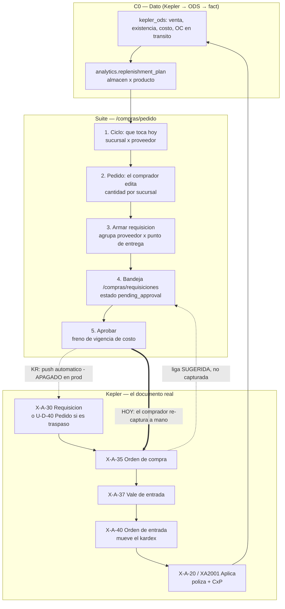

# Flujo de compra — `/compras/pedido` contra el de Kepler

> **Qué contesta este doc:** *qué pasa, en qué orden, quién lo hace y qué documento queda* cuando
> alguien compra en la Suite — y en qué se parece y en qué NO al flujo que Mega Dulces ya opera en
> Kepler.
>
> ⛔ **Qué NO contesta:** cómo se calcula el sugerido (cobertura, colchón, fill rate, safety stock,
> redondeo, tope de 45 días). Eso vive en [`FASE_RA`](IMPLEMENTACION/FASES/FASE_RA_REABASTECIMIENTO.md)
> y en [`FASE_RA_PRO8`](IMPLEMENTACION/FASES/FASE_RA_PRO8_CICLOS_REABASTO.md). Acá el motor es una
> caja negra que propone un número; lo que se documenta es el **camino del documento**.
>
> **Fecha de corte: 2026-10-16.** Lo que está medido trae su fecha. Lo que no se midió se dice.
>
> ⭐ **El flujo completo, hasta el pago** (recepción, deuda, calendario, pago, póliza y conciliación),
> medido el 2026-10-26, está en [`FLUJO_COMPRA_A_PAGO.md`](FLUJO_COMPRA_A_PAGO.md). Este doc queda como
> el detalle del tramo pedido → requisición. ⚠️ Lo que cambió desde su corte (el empuje a Kepler se
> apagó el 2026-10-26; `c16` trae IVA) está en aquel §4.2 y §10.

---

## 1. Los dos flujos, en una tabla

| | **Suite — `/compras/pedido`** | **Kepler** |
|---|---|---|
| Para qué existe | **Decidir** qué, cuánto y cuándo comprar | **Registrar** lo que se compró |
| Cuándo se usa | **Antes** de pedirle al proveedor | ⭐ Mayormente **al recibir** la mercancía |
| Qué dispara el ciclo | La cadencia del proveedor × sucursal ("toca hoy") | Que llegó el camión |
| Primer documento | Requisición `RQ-YYYY-NNNNN` | Requisición `X-A-30` (opcional) u **OC `X-A-35` directa** |
| Quién aprueba | HITL explícito: `pending_approval → approved` | No hay paso de aprobación en el documento |
| Qué mueve inventario | Nada hasta la OE (`commercial.goods_receipts`, overlay) | **Sólo `X-A-40`** (única que toca el kardex `kdij`) |
| Verdad del inventario | ⛔ No es la Suite | ⭐ **Kepler** (ADR-031) |
| Trazabilidad hacia atrás | Requisición → lote → renglón → sugerido del motor | Cadena `c36`–`c39` entre documentos hijos |

⭐ **La diferencia de fondo, en una línea:** *Kepler no planea, levanta acta.* La Suite existe para
el tramo que al ERP le falta —**decidir antes**— y después tiene que aterrizar en los documentos
del ERP, porque ahí es donde viven el inventario, la CxP y la contabilidad.

**Lo que lo prueba, medido:**

- La OC `X-A-35` se captura **cuando llega la mercancía**: en CEDIS **81.0 %** de las OCs cierran el
  **mismo día** (p50 = 0 días, p90 = 4); en sucursales, 94.6–100 %. *(medido 2026-08-29, sobre la
  ventana de 200–30 días ya resuelta)*. Una OC abierta en Kepler **no es pipeline: es un documento
  estancado**.
- **504 de 781 OCs nacen directas**, sin requisición previa *(ADR-031, verificado en `md_03` el
  2026-07-10)*. La requisición en Kepler es opcional y mayormente ceremonial.

---

## 2. El flujo de la Suite, paso a paso



### Paso 0 — El dato llega solo (capa C0)

`analytics.replenishment_plan` se refresca desde el ODS de Kepler
(`database/importers/kepler/import-replenishment-plan.js`): venta, existencia, costo de caja,
política de reorden y OC en tránsito, por **almacén × producto**. El comprador no carga nada.

⚠️ La existencia del ciclo sale del **fact**, no de la copia `commercial.stock` — la copia erraba
**316,169 piezas (−6.7 %)** sobre los 36,048 pares con política *(medido contra prod 2026-10-15)*.

### Paso 1 — «Ciclo»: qué toca hoy

Pestaña **Ciclo** (`worklist`). Lista los canales **sucursal × proveedor** cuya cadencia vence:
*vencidos · toca hoy · próximos 7 días*. Es **el disparador del flujo**, y es justo lo que Kepler no
tiene: ahí nadie te avisa que a De la Rosa le toca pedirle hoy.

### Paso 2 — «Pedido»: el comprador decide

Pestaña **Pedido**. Una fila por producto; al abrirla, el **desglose por sucursal** con lo que el
motor propone (`seed`, ya redondeado y topado) y un input editable. Tres tipos de renglón conviven:

| chip | qué es | a dónde va |
|---|---|---|
| **Comprar** | lo que hay que desembolsar | requisición de compra (`source_type='supplier'`) |
| **Traspaso** | lo que se resuelve moviendo del CEDIS | requisición de traspaso (`source_type='branch'`) |
| **Sobrestock** | lo inmovilizado | no se pide; es contexto |

Las otras tres pestañas no son del camino del documento: **Sobrante** y **Stock muerto** son
diagnóstico, y **Flujo** es el espejo del paso 9.

⚠️ El comprador puede **consolidar**: la compra se entrega en el CEDIS y baja por traspaso a la
sucursal. Eso se avisa **antes** de armar, porque genera **dos** documentos.

### Paso 3 — «Armar requisición»

`buildReq()` en [`compras-pedido-real.component.ts`](../apps/view/src/app/modules/compras/pages/compras-pedido-real.component.ts).
Lo marcado se agrupa y se mandan N documentos en un **lote** (`batch_folio`):

- **compra** → agrupada por *(proveedor × dónde ENTREGA el proveedor)*, no por quién la necesita;
- **traspaso de consolidación** → *(destino × CEDIS)*, apuntando a la compra que lo originó;
- **traspaso puro** → *(destino × origen)*.

⚠️ Un «Armar» genera **8.2 documentos en promedio y 117 en el peor caso** *(82 generaciones medidas
en prod)*. Por eso la bandeja agrupa por lote.

Salidas alternas del mismo paso, que **no** crean documento: **XLSX** del alcance y **PDF de orden de
requisición** (global o por proveedor).

### Paso 4 — La bandeja: `/compras/requisiciones`

Estado inicial **`pending_approval`**. La bandeja tiene vista por **lote** o por **documento**, y
avisa de las atascadas (más de 30 días).

### Paso 5 — Aprobar

`approve()`. **El freno es medido, no una política:** una requisición de 31–60 días tiene el
**83.5 %** de sus renglones con el costo ya movido, y una de 60+ el **98.7 %** *(prod, 2026-10-06)*.
Aprobar eso es ordenar a un precio que no existe. La salida es de un clic: **Recalcular** (toca el
costo, **nunca** la cantidad) y aprobar.

⚠️ Si no hay con qué medir, **no frena**: castigar la ausencia de medición es dibujar un veredicto
que nadie emitió (ADR-056).

### Paso 6 — El salto al ERP *(hoy, a mano)*

Al aprobar cuelga el empuje a Kepler (`[KR.5]`). **Hoy está apagado en producción**: tres candados
independientes y los tres puestos *(estado del runbook al 2026-10-14; no re-medido contra prod el
2026-10-16)*:

| candado | estado |
|---|---|
| Binding del puerto `KEPLER_REQUISITION_SINK_PORT` | ✅ ligado en el módulo |
| `KEPLER_PUSH_URL` en el entorno de prod | ⛔ falta |
| `GRANT INSERT` sobre `md.kdm1`/`kdm2` + `pg_hba` desde `192.168.0.222` | ⛔ falta |

**O sea que el flujo real de hoy es: la requisición se captura DOS veces** — una en la Suite y otra
a mano en Kepler. Quitar esa segunda captura es exactamente el objetivo de
[`FASE_KR`](IMPLEMENTACION/FASES/FASE_KR_REQUISICION_A_KEPLER.md) / ADR-092.

### Paso 7 — «Ordenada»: la coordenada de la OC

`markOrdered` **exige** sucursal + folio de la OC de Kepler. No es un campo más: la junta
requisición↔OC **no existía** antes del 2026-10-09 — había **53 requisiciones `ordered` por
$11,586,824** que no se podían seguir hasta la entrada de mercancía.

### Paso 8 — «Recibida»

Dos caminos, y no son equivalentes:

- **Atajo** `markReceived`: marca `received` y captura `received_qty` por línea (base del fill rate).
  Se **bloquea** si la requisición ya generó una OC interna no cancelada, para no contar doble.
- **Cadena interna** (RA.15 / ADR-031): OC propia `OC-YYYY-NNNNN` → OE `OE-YYYY-NNNNN`, que **sí
  mueve `commercial.stock`** como *overlay optimista*. El snapshot nocturno de Kepler re-sincroniza:
  **Kepler es la verdad del inventario, nosotros la planeación**.

### Paso 9 — «Flujo»: el lazo se cierra leyendo el ERP

Pestaña **Flujo** (`[RA-PRO.63]`). Por cada requisición del periodo dice hasta dónde llegó:

`con_entrada` · `en_oc` (sin entrada) · `esperando` · `sin_oc` · `sin_fuente` (almacén Wincaja, no
hay OC que buscar).

⛔⛔ **La liga requisición→OC es SUGERIDA, no un hecho**, y la pantalla lo declara con su confianza
(`alta`/`media`, y `ambigua` cuando empata). Se busca la OC de la misma sucursal y proveedor en los
días siguientes y se elige la que trae más productos de la requisición.

⚠️ **No se compara la cantidad, a propósito:** la OC no es la requisición copiada — el comprador arma
su propia orden y a veces junta varias requisiciones. **Medido: la OC trae de 0.1× a 94× lo pedido
del mismo producto.** Por eso requisición→OC se mide como *"¿el producto entró a la OC?"* y
OC→entrada **en dinero**.

---

## 3. El flujo de Kepler, paso a paso

```
X-A-30 Requisicion   (opcional — 504/781 OCs nacen sin ella)
  -> X-A-35 Orden de compra
    -> X-A-37 Vale de entrada
      -> X-A-40 Orden de entrada      <- UNICA que toca el kardex kdij
        -> X-A-20 / XA2001 "Aplica"   <- el ANCLA: el proveedor la firma,
                                         genera la poliza (511/201/122) y la CxP
```

Y el traspaso entre sucursales es **otra cadena, en otro género**:

```
U-D-40 Pedido            <- solicitud (no mueve nada)
  -> U-D-41 Embarque     <- SALE el inventario del origen
    -> U-A-50 Recepcion  <- ENTRA en el destino
```

**Lo medido sobre esta cadena:**

| hecho | medido |
|---|---|
| Enlace entre documentos | `c36`/`c37`/`c38`/`c39` del **hijo**, nunca del padre |
| Estatus del documento | `kdm1.c43`: `N` pendiente · `F` finalizada · `C` cancelada · `R` recibida |
| Vencimiento de la CxP | `c18` ya calculado (= `c9` + días de `c30`), columna limpia |
| Unidad de la línea de OC | `c11`: PAQ 64 % · PZA 28 % · KG 5 % · **`CJA` 24 de 17,810 (0.13 %)** |
| Importe | `c9 × c12 = c13` al centavo — **invariante a la unidad** |
| `U-D-40` vivo | 955 pedidos en 120 días, **92.8 %** derivaron en su embarque |

⛔ **Lo que Kepler NO tiene, y por eso existe la Suite:**

- nadie avisa cuándo toca pedirle a un proveedor (no hay cadencia);
- no hay sugerido por demanda que descuente lo que ya viene en camino;
- no hay paso de **aprobación** sobre el documento;
- el **Total Factura del proveedor** es externo (lo pone el OCR), así que el cuadre a 3 vías no
  existe dentro del ERP.

---

## 4. Mapa de correspondencia

| Estado Suite | Qué significa | Documento Kepler equivalente | ¿Quién lo crea hoy? |
|---|---|---|---|
| `draft` | no se usa desde Pedido | — | — |
| `pending_approval` | armada, esperando criterio | ninguno — **Kepler no tiene este paso** | Suite |
| `approved` | aprobada | `X-A-30` (compra) / `U-D-40` (traspaso) | ⛔ una persona, a mano (KR apagado) |
| `ordered` + `oc_sucursal`/`oc_folio` | se le ordenó al proveedor | `X-A-35` | persona, en Kepler |
| — | mercancía en puerta | `X-A-37` → `X-A-40` | Kepler |
| `received` + `received_qty` | entró | `X-A-20` / XA2001 (ancla, póliza, CxP) | Kepler |
| `cancelled` | rechazada | `c43='C'` (cancelada) | — |

⚠️ **`kepler_folio` ≠ `oc_folio`.** Son dos columnas distintas a propósito: la primera es la
requisición **que escribimos nosotros**, la segunda la OC **que capturó una persona**. Confundirlas
haría que *"esto ya se pidió"* y *"esto ya se compró"* fueran el mismo dato.

---

## 5. Las cinco diferencias que importan

1. **Momento.** La Suite decide antes de comprar; Kepler registra al recibir. Cualquier métrica de
   *lead time* o *tránsito* sacada de Kepler sale de la muestra sesgada del ~16 % que sí se capturó
   antes de recibir *(2026-08-29)*.
2. **Aprobación.** El HITL es nuestro y no tiene espejo en el ERP: al empujar, el `X-A-30` nace ya
   aprobado. Por eso el empuje cuelga de **aprobar** y no de **armar** — empujado al armar, Kepler se
   llenaría de borradores rechazables **que no podemos borrar** (el rol de escritura no tiene
   `DELETE`, a propósito).
3. **Grano.** Nuestra requisición es *(proveedor × punto de entrega)*; la OC de Kepler la arma el
   comprador y **junta varias requisiciones**. La relación es **N:M**, nunca 1:1.
4. **Unidad.** La Suite piensa en **cajas** (`final_qty`); Kepler expresa la línea en la unidad del
   producto y declara la caja aparte (`c55`/`c58`). El push escribe `CJA` **sin convertir**, decisión
   del 2026-10-14: el factor de caja no se pudo fijar en tres intentos, y *convertir mal en silencio
   es peor que una etiqueta inusual*. Está probado que Kepler **copia** el renglón entre documentos
   (22 de 22 requisiciones con `CJA` llegaron hasta la entrada con razón **1.0000**).
5. **Traspaso.** Son cadenas distintas: `X-A-30`→`X-A-35` contra `U-D-40`→`U-D-41`→`U-A-50`. El
   destino viaja como **pseudo-cliente `TI###`** y ⛔ **no se infiere del número de sucursal**
   (`02` La Piedad = `TI008`, `03` 8 Esquinas = `TI002`): sale de `md.pv_suc_ip`. Y el documento se
   crea en el **origen**, al revés que la compra.

---

## 6. Lo que está roto o sin cerrar en la costura

| # | Qué pasa | Evidencia |
|---|---|---|
| 1 | **Doble captura.** La requisición se teclea en la Suite y otra vez en Kepler | KR apagado, runbook 2026-10-14 |
| 2 | **La bandeja no se vacía.** 610 pendientes por **$42.7 M**, 24 días de promedio, 77 días la más vieja | prod 2026-10-06 |
| 3 | **La liga req→OC es inferida**, no capturada — y la pestaña Flujo lo declara | 310 requisiciones seguían en `pending_approval` el 2026-09-26 |
| 4 | **El lote NO empuja a Kepler.** Aprobar hasta 200 de una deja `kepler_folio` en NULL y hay que reintentar | `[KR.5]`, decisión explícita contra el timeout |
| 5 | **El sink no es idempotente**; la idempotencia la pone `pushToKepler` mirando `kepler_folio` | `RQ-2026-00807` salió 2 veces el 2026-10-13: **$175,608.84 pedidos para una necesidad de $87,804.42** |
| 6 | **La línea de compra no guarda de qué sucursal era**, así que el push consolida por SKU | `source_warehouse_id` va NULL en las de compra |
| 7 | ⚠️ **Prosa rancia:** el comentario de `pushKeplerTrasAprobar` todavía dice que *"los traspasos se OMITEN"* citando `N-A-6` muerto. **El código ya los empuja** como `U-D-40` desde `[KR.10]` | `commercial-replenishment.service.ts` contra `kepler-requisition-sink.port.ts` |

---

## 6-bis. El cuadre, medido contra prod y contra Kepler (2026-10-16)

> Leído en vivo: prod `pg-prod` (`system_identifier 7688376744939610156`) y las réplicas Kepler
> `kepler_md_00..07` (último documento replicado: 2026-10-16). Sólo lecturas.

### a) La coordenada que escribimos nosotros: 1 de 901, y apunta a un documento que ya no existe

| | |
|---|---:|
| Requisiciones en prod | **901** |
| Con `kepler_folio` (documento escrito por el sink) | **1** |
| Con `kepler_error` = *"KEPLER_PUSH_URL sin configurar"* | **51** |
| Documentos marcados `RQ-` encontrados en las 8 ramas de Kepler | **0** |

⛔ `RQ-2026-00807` guarda la coordenada `00 / X-A-30 / 0003114`, pero **el folio máximo vivo de
`X-A-30` en la sucursal `00` es `0003110`**: el documento fue de los que se borraron al terminar la
prueba del 2026-10-13, y la liga quedó **colgando**. Nadie la puede notar desde la Suite — se ve
igual que una requisición entregada.

⭐ Los 51 `kepler_error` son la prueba viva de que **el camino está cableado y apagado**: la gente
aprueba, el empuje se intenta y falla por configuración. No es una fase dormida, es una fase a medio
encender.

### b) La coordenada de la OC: 0 de 901, y el motivo no es que a nadie se le olvide

| | |
|---|---:|
| Requisiciones con `oc_folio` capturado | **0** |
| `ordered` / `received` **sin** `oc_folio` | **121** |
| …de ellas, posteriores a la migración `[RQ.15]` del 2026-10-09 | **78** |
| OC **internas** (`commercial.purchase_orders`) ligadas a una requisición | **121** |

⭐ **Los números calzan exactamente: 121 y 121.** O sea que el estado `ordered` no lo está poniendo
`markOrdered` —el que exige sucursal + folio de Kepler— sino la **cadena interna RA.15**
(`createPOFromRequisition`), que mueve la requisición a `ordered` sin pedir nada del ERP. El campo
obligatorio existe y **el camino que de verdad se usa lo rodea**. Mientras eso siga así, `oc_folio`
va a seguir en cero por diseño, no por descuido.

### c) ¿Aterrizan nuestras requisiciones en Kepler? Cruce con control placebo

Universo: **121 requisiciones de COMPRA** (`approved`/`ordered`/`received`, ramas Kepler, 120 días)
contra **8,885 documentos** `X-A-30` + `X-A-35` de Kepler.

| prueba | ventana real `[f, f+15d]` | ventana placebo `[f−30, f−15d]` |
|---|---:|---:|
| Hay **algún** documento del mismo proveedor + sucursal | 59 (48.8 %) | 43 (35.5 %) |
| …y además con el **mismo importe** (±0.5 %) | **6 (5.0 %)** | **0 (0.0 %)** |

⭐ **Seis contra cero: el cruce por importe NO es ruido.** Esas seis son requisiciones nuestras
re-tecleadas a mano en Kepler como orden de compra.

Y la cobertura por SKU completa el cuadro:

| qué tan bien cubre UNA OC de Kepler los SKUs de la requisición | requisiciones | % |
|---|---:|---:|
| **100 %** de los SKUs | **47** | 38.8 % |
| 70–99 % | 5 | 4.1 % |
| 40–69 % | 3 | 2.5 % |
| 1–39 % | 2 | 1.7 % |
| hay documento del proveedor, pero **ningún** SKU en común | 2 | 1.7 % |
| **no hay ningún documento de ese proveedor** en la ventana | **62** | **51.2 %** |

⭐ **47 aterrizan completas en lista, 6 aterrizan completas en lista Y en dinero.** La diferencia
entre 47 y 6 es exactamente lo que la pestaña Flujo ya declaraba: *el comprador pide los mismos
productos pero cambia las cantidades*. Las 62 sin documento son la pregunta abierta — o se pidieron
fuera de la ventana de 15 días, o en otra sucursal, o no se pidieron.

### d) ⭐⭐ Columna por columna: cuadra el DINERO, no la CANTIDAD — y la diferencia es `c58`

Comparación renglón por renglón de los 6 pares, **37 SKUs presentes en ambos lados**:

| columna | cuadra | detalle |
|---|---:|---|
| Proveedor (`c10`) | **6/6** | idéntico |
| Fecha (`c9`) | **6/6** | **0 días** de diferencia en los seis |
| Total del documento (`c16`) | **6/6** | al centavo |
| Conjunto de SKUs | **6/6** | mismo número de renglones, ninguno de más ni de menos |
| **Importe del renglón** (`c13`) | **37/37 (100 %)** | al centavo |
| **Cantidad del renglón** (`c9`) | **0/37 (0 %)** | ⚠️ unidades distintas |
| **Costo unitario** (`c12`) | **0/37 (0 %)** | ⚠️ misma razón |

⭐⭐ **Y no es un descuadre: es la escalera de unidades, y se cierra con `kdm2.c58`.** En los 37
renglones, sin una sola excepción:

```
cantidad_kepler = cantidad_suite (cajas) x c58
costo_kepler    = costo_suite    (caja)  / c58
importe         = invariante  -> por eso cuadra al centavo
```

Ejemplos medidos: 65 cajas → **1,560 PAQ** con `c58=24`, costo 172.51 → 7.187917; 5 cajas →
**500 PZA** con `c58=100`, costo 810 → 8.10; 600 cajas → **12,000 PZA** con `c58=20`, costo 48 →
2.40.

⚠️ **Esto NO refuta la decisión `[KR.6]`** de escribir `CJA` sin convertir — contesta **otra**
pregunta. Aquella midió si `c58` coincide con el factor de caja del catálogo de la Suite en todo el
universo (86.6 % sobre 4,842 SKUs). Ésta mide si `c58` es el factor que reconcilia **nuestra caja**
con **la línea que un humano escribió partiendo de nuestra requisición**: ahí es **37 de 37**.
Son 37 renglones de 6 documentos en dos sucursales — muestra chica, cero contraejemplos.

### e) Lo que el cruce dejó ver de nuestro lado

Tres pares de requisiciones distintas con **el mismo proveedor, el mismo importe y los mismos SKUs**
apuntan a la misma OC: `RQ-2026-00461`/`00468` ($245,670.00), `RQ-2026-00792`/`00802` ($30,350.00) y
`RQ-2026-00760`/`00774` ($100,571.91). Es el patrón de *"se pidió lo mismo dos veces"* que la propia
pantalla ya avisa al armar; acá queda medido que **llega hasta la bandeja**.

---

## 7. Lo que este doc NO midió

- **El traspaso.** Todo el cruce de §6-bis es sobre requisiciones de **compra**. Las de traspaso
  (`source_type='branch'`, la mayoría del volumen) tendrían que medirse contra `U-D-40`, y no se
  hizo.
- **Las 62 sin documento del proveedor.** Se sabe que no hay OC de ese proveedor en `[f, f+15d]`;
  no se buscó fuera de esa ventana, ni en otra sucursal, ni se preguntó a compras.
- **Las ramas que no son Kepler.** El almacén con `kepler_code='08'` (85 requisiciones) no tiene
  réplica `kepler_md_08`: queda fuera del cruce y se declara, no se cuenta como "no cuadra".
- **Cuánto tarda el camino completo** (armar → aprobar → OC → entrada). No se puede medir de punta a
  punta mientras `oc_folio` siga en cero.

---

## 8. Dónde mirar

| Para | Archivo |
|---|---|
| **El procedimiento de cada paso** | [`PROCEDIMIENTOS/COMPRAS/`](PROCEDIMIENTOS/COMPRAS/README.md) — 9 fichas + el diseño de las actas |
| La pantalla | [`compras-pedido-real.component.ts`](../apps/view/src/app/modules/compras/pages/compras-pedido-real.component.ts) |
| La pestaña Flujo | [`compras-flujo.component.ts`](../apps/view/src/app/modules/compras/pages/compras-flujo.component.ts) · [`purchase-flow.service.ts`](../libs/commercial/src/lib/commercial-replenishment/purchase-flow.service.ts) |
| Estados y transiciones | [`commercial-replenishment.service.ts`](../libs/commercial/src/lib/commercial-replenishment/commercial-replenishment.service.ts) (`approve` / `markOrdered` / `markReceived` / `pushToKepler`) |
| La puerta al ERP | [`kepler-requisition-sink.port.ts`](../libs/contracts/src/ports/kepler-requisition-sink.port.ts) · [`kepler-requisition-sink.adapter.ts`](../libs/commercial/src/lib/commercial-replenishment/kepler-requisition-sink.adapter.ts) |
| Encenderlo | [`RUNBOOKS/KEPLER_PUSH_DESPLIEGUE.md`](IMPLEMENTACION/RUNBOOKS/KEPLER_PUSH_DESPLIEGUE.md) |
| El motor (fuera de alcance acá) | [`FASE_RA`](IMPLEMENTACION/FASES/FASE_RA_REABASTECIMIENTO.md) · [`FASE_RA_PRO8`](IMPLEMENTACION/FASES/FASE_RA_PRO8_CICLOS_REABASTO.md) |
| La cadena de Kepler | [`ERP_KEPLER.md` §3](ERP_KEPLER.md) · ADR-031 · [`FASE_RE`](IMPLEMENTACION/FASES/FASE_RE_RECEPCION_MERCANCIA.md) |
| La otra audiencia | `/almacen/autoabasto` (Fase AB) — mismo motor, decisión distinta: *qué pedir y a quién* |
