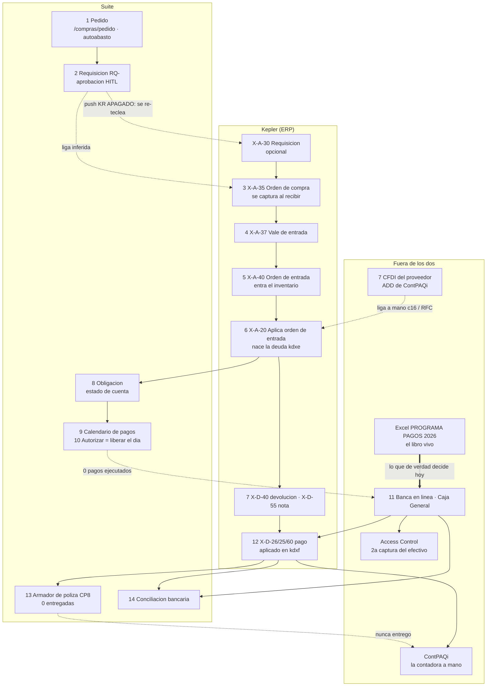

# De la compra al pago — el flujo completo

> **Qué contesta:** qué pasa, en qué orden, quién lo hace, en qué sistema y qué documento queda,
> desde que se decide comprar mercancía hasta que el pago está contabilizado y conciliado con el
> banco. Y en cada paso, **hasta dónde se puede seguir un peso** y dónde se rompe la cadena.
>
> ⛔ **Qué NO contesta:** el cálculo del sugerido ([`FASE_RA`](IMPLEMENTACION/FASES/FASE_RA_REABASTECIMIENTO.md))
> ni el detalle de pantallas del tramo pedido → requisición, que sigue en
> [`FLUJO_COMPRAS_PEDIDO.md`](FLUJO_COMPRAS_PEDIDO.md) (corte 2026-10-16; lo que cambió está en §4.2 y
> §10). Gastos (`X-A-10`/`X-A-15`) y nómina quedan fuera.
>
> **Corte: 2026-10-26.** Las cifras sin fecha se midieron ese día contra producción (`pg-prod`,
> `system_identifier 7688376744939610156`), en sólo lectura, de 12:28 a 12:41. **Universo:**
> documentos de Kepler con fecha `c9` del 2026-01-01 al 2026-10-25, sin réplicas entre sucursales
> (`c1 = sucursal`) y sin cancelados (`c43 = 'C'`). Cada partición cuadra contra su total y cada liga
> se probó contra un placebo. Las cifras con otra fecha vienen del doc de fase citado; la deducción
> se marca **INFERIDO**.
>
> **El espejo** —de la venta al cobro— está en [`FLUJO_VENTA_A_COBRO.md`](FLUJO_VENTA_A_COBRO.md). Los dos se
> tocan en Caja General: el efectivo que entra por cobranza de rutas es el que sale a pagar proveedores.
>
> **«Oficinas»** es el servidor central de Kepler, que concentra la compra y el pago (el sistema lo
> rotula «CEDIS»; el CEDIS físico vivía en Wincaja hasta el 30-sep, ver [`ERP_KEPLER.md`](ERP_KEPLER.md)
> §2.3). **«Sucursales»** son las otras ocho plazas.

**Contenido:** §1 [El flujo en una pantalla](#1-el-flujo-en-una-pantalla) · §2 [Lo que dice la medición](#2-lo-que-dice-la-medición) · §3 [Volumen 2026](#3-volumen-2026) · §4 [Paso a paso](#4-paso-a-paso) · §5 [Las ligas](#5-las-ligas-hasta-dónde-se-puede-seguir-un-peso) · §6 [Tiempos](#6-tiempos) · §7 [Lo que está roto](#7-lo-que-está-roto-ordenado-por-dinero-en-riesgo) · §8 [Decisiones abiertas](#8-decisiones-abiertas) · §9 [Lo que NO se midió](#9-lo-que-no-se-midió) · §10 [Docs desactualizados](#10-docs-que-quedaron-desactualizados) · §11 [Dónde mirar](#11-dónde-mirar)

---

## 1. El flujo en una pantalla

La cadena como se cuenta de palabra —*pedido → requisición → orden de compra → vale de entrada →
orden de entrada → obligaciones a proveedor → calendario de pagos*— es correcta, pero le faltan
**cuatro eslabones que deciden dinero**:

1. **«Aplica orden de entrada» (`X-A-20`)**, entre la orden de entrada y la obligación: ahí **nace
   la deuda** y la póliza de compra.
2. **La factura del proveedor (CFDI)**, que entra **por fuera** de Kepler y se liga a mano.
3. **Devoluciones y notas de crédito** (`X-D-40`, `X-D-55`), que reducen lo que se debe.
4. **Lo que pasa después del calendario**: autorizar, pagar, registrar el pago en Kepler y aplicarlo a
   las facturas, la póliza en ContPAQi y la conciliación con el banco. **El ciclo no cierra en el
   calendario: cierra cuando el pago está aplicado, contabilizado y conciliado.**

| # | Paso | Quién | Sistema · documento | Estado hoy |
|---|---|---|---|---|
| 1 | Pedido | Gerencia de Compras; la sucursal en autoabasto | Suite `/compras/pedido` · `/almacen/autoabasto` | en uso |
| 2 | Requisición | arma Compras; aprueba una persona con el permiso | Suite `RQ-AAAA-NNNNN` · Kepler `X-A-30` (opcional) | **se re-teclea en Kepler** |
| 3 | Orden de compra | Compras | Kepler `X-A-35` · Suite OC interna `OC-…` | Kepler la captura **al recibir** |
| 4 | Vale de entrada | quien recibe | Kepler `X-A-37` | mismo acto que 5 y 6 |
| 5 | Orden de entrada (entra el inventario) | quien recibe | Kepler `X-A-40` | mismo acto |
| 6 | Aplica orden de entrada (**nace la deuda**) | quien recibe | Kepler `X-A-20` → `kdxe` | estructural, 100 % |
| 7 | Factura y ajustes | proveedor · Compras | ADD de ContPAQi · Kepler `X-D-40`/`X-D-55` | liga factura↔entrada **no se guarda** |
| 8 | Obligación (saldo y vencimiento) | se deriva | Kepler `kdxe`/`kdxf` · Suite `v_supplier_payables` | sólo lectura |
| 9 | Calendario (qué se paga qué día) | Tesorería; el tope, Presupuestos | Suite `/finanzas/calendario-pagos` · **Excel de Tesorería** | Suite sin uso real; **manda el Excel** |
| 10 | Autorización | rol `direccion` (en la práctica, superadmin) | Suite: liberar el día | **nunca ejercida** |
| 11 | Ejecución | Tesorería (banco) · Caja General (efectivo) | banca en línea · CAOS/cajón | fuera de la Suite |
| 12 | Registro del pago y aplicación a facturas | Caja General / Tesorería; el efectivo, otra vez en Access | Kepler `X-D-26/25/60` + `kdxf` | **doble captura** del efectivo |
| 13 | Póliza contable | la contadora | ContPAQi a mano · Suite puente CP8 | puente **0 entregadas** |
| 14 | REP y conciliación | proveedor · Finanzas | ADD de ContPAQi · Suite `/finanzas/bancos` | conciliación por botón |

---

## 2. Lo que dice la medición

1. **Kepler no planea, levanta acta.** Requisición, OC, vale, orden de entrada y aplica se capturan
   **el mismo día** (mediana 0 días en los cuatro tramos), y la misma persona captura vale, orden de
   entrada y aplica en el 92–95 %. Kepler **no puede decir cuánto tarda un proveedor en entregar**.
2. **Dentro de Kepler la cadena es sólida de la recepción hacia atrás:** aplica → orden de entrada
   100 %, orden de entrada → vale 100 %, vale → OC 81–91 %, OC → requisición ~40 %. Contra placebo,
   el proveedor casa en 13–31 %; con la liga real, en 99–100 %.
3. **La costura Suite → Kepler está rota.** De 1,446 requisiciones, **1** tiene folio de Kepler (una
   cancelada) y **0** el de la OC. La requisición se captura dos veces; el empuje automático está
   apagado desde hoy.
4. **La deuda nace limpia.** El 100 % de las aplica está en la CxP de Kepler (`kdxe`) con el mismo
   vencimiento, importe y acreedor; el vencimiento es fecha + plazo exacto en el 91.7 % (±1 día en el
   98.9 %).
5. **Se paga tarde.** En Oficinas, de las entradas de ene–ago, el 91.3 % (93.6 % del dinero) ya tiene
   pago, con **mediana de 13 días después del vencimiento** (p90 59). Sólo el **19 %** se pagó a
   tiempo, y el descuento por pronto pago capturado en 2026 suma **$17.11M**.
6. **En sucursales, «saldada» no es «pagada».** 1,389 de 1,624 entradas de sucursal de ene–ago se
   saldaron **sólo con notas de «blanqueo»** del 30-sep y 9-oct, no con un pago.
7. **El efectivo es la mayoría de los pagos y la minoría del dinero:** 59.5 % de los pagos de
   mercancía (3,193), 13.2 % del dinero ($61.49M). El banco mueve el 81.1 %.
8. **El calendario de la Suite no está en el camino del dinero:** 0 pagos ejecutados en su historia.
   Del 19 al 25-oct salieron $7.08M según Kepler y el calendario tenía comprometidos $1.12M.
9. **La póliza del pago se teclea a mano.** El armador de la Suite nunca entregó una; 2,725 pagos en
   efectivo por $35.67M no tienen póliza.
10. **Ninguna liga entre sistemas se guarda.** Suite ↔ Kepler, factura ↔ entrada, calendario ↔ pago,
    Kepler ↔ Access y pago ↔ póliza se reconstruyen por importe y fecha cada vez.

---

## 3. Volumen 2026

Proveedores de compra (código `C…`); traspasos entre plazas (`TI…`) aparte.

| Paso | Kepler | Docs | $M | traspaso `TI`: docs / $M |
|---|---|---:|---:|---:|
| Requisición | `X-A-30` | 3,841 | 150.31 | 433 / 15.58 |
| Orden de compra | `X-A-35` | 9,478 | 543.56 | 924 / 33.78 |
| Vale de entrada | `X-A-37` | 11,715 | 558.93 | 926 / 34.34 |
| Orden de entrada | `X-A-40` | 11,601 | 548.80 | 918 / 33.90 |
| **Aplica orden de entrada** | `X-A-20` | **11,335** | **539.05** | 872 / 31.14 |
| Devolución de compra | `X-D-40` | 235 | 1.23 | 13 / 0.13 |
| Nota de crédito | `X-D-55` | 1,568 | 72.26 ⚠️ | 18 / 37.50 |
| Pago por transferencia | `X-D-26` | 5,005 | 397.72 | — |
| Pago por cheque | `X-D-25` | 256 | 54.84 | — |
| Anticipo | `X-D-60` | 109 | 14.34 | — |

- Control: clases + sucursales + réplicas + cancelados = crudo, en los 10 tipos. Segunda
  implementación: `analytics.erp_goods_receipts` da la misma `X-A-20` (8,550 / $456.41M Oficinas +
  3,679 / $114.39M sucursales).
- ⚠️ Las notas de Oficinas ($23.2M) son comerciales (descuento, apoyo de marca, pronto pago); las de
  sucursal son casi todas **blanqueo** (195 notas, $85.52M). Ver §4.6.
- **Compra directa `X-A-5` (inventario + deuda de golpe): 0 en 2026.** Toda la mercancía pasa por la
  cadena. Kepler tiene un «Solicitud Pago Proveedor» (`X-D-10`) y se usó **3 veces**: programar el
  pago no vive en el ERP.

---

## 4. Paso a paso

### 4.1 Pedido

«Pedido» nombra **cinco cosas** en el sistema; sólo las dos primeras arrancan una compra:

| # | Qué es | ¿Se guarda? | Quién |
|---|---|---|---|
| 1 | Pestaña **Pedido** de `/compras/pedido`: el comprador ajusta lo que propone el motor | **no**, es un carrito hasta «Generar requisición» | Gerencia de Compras (671 de 1,008 renglones, 2026-10-23); Dirección 170 |
| 2 | **«Mi pedido»** de autoabasto (`commercial.autoabasto_pedidos`) | sí | la sucursal; medido 2026-10-23: 22 de 23 usos fueron de Dirección |
| 3 | **`U-D-40` «Pedido»** de Kepler: la requisición de un **traspaso** | sí | la matriz (571 en 30 días, 481 de un usuario) |
| 4 | PDF de la OC interna de `/compras/ordenes` («pedido al proveedor») | sí | Compras, **después** de la requisición |
| 5 | Pedido de venta (portal, telemarketing) | — | no es compras |

A la requisición pasan la cantidad sugerida y la final. ⛔ La base del sugerido (mínimo, punto de
reorden, máximo) va en **0 en los 1,008 renglones medidos** (`[RA-MED.3]`): la requisición no puede
explicar después por qué pidió eso. Del pedido de sucursal no hay llave a la requisición, sólo la
marca `requested_by_branch`.

### 4.2 Requisición

- **Suite:** `RQ-AAAA-NNNNN` en `commercial.purchase_requisitions` (+ `_lines`); un «Armar» genera un
  lote `RQ-LOTE-…`. Estados: `pending_approval` → `approved` → `ordered` → `received`, o `cancelled`.
  Crear pide `COMPRAS_REQUISICIONES_GESTIONAR`; aprobar y rechazar, `…_AUTORIZAR`. Aprobar frena si
  el costo ya no es el de hoy; aprobar en bloque **no** empuja a Kepler. Detalle en
  [`FLUJO_COMPRAS_PEDIDO.md`](FLUJO_COMPRAS_PEDIDO.md) §2.
- **Quién aprueba:** el permiso se da por persona; una sola hizo **849 de 863** aprobaciones en 30 días
  (2026-10-23).
- **Kepler `X-A-30`** es **opcional**: la traen el 41.9 % de las OC de Oficinas y el 38.5 % de las de
  sucursal.
- **El empuje a Kepler (Fase KR) está apagado desde el 2026-10-26** (se borró el secreto). El 24-oct el
  canario de Yurécuaro escribió un documento real y la baja desde Kepler falló (`c24`); los arreglos
  `[KR.16]`/`[KR.17]` no están desplegados ([runbook](IMPLEMENTACION/RUNBOOKS/KEPLER_PUSH_DESPLIEGUE.md) §8–§11).
- **Medido hoy** (1,446 requisiciones, 21-jul → 26-oct):

  | Tipo | approved | ordered | received | cancelled | Total |
  |---|---:|---:|---:|---:|---:|
  | Compra | 81 | 138 | 26 | 294 | 539 |
  | Traspaso | 717 | 63 | 0 | 127 | 907 |

  Con folio de Kepler: **1** (cancelada). Con folio de OC de Kepler: **0**, aun en las 164 de compra
  `ordered`/`received`.
- ⛔ **`approved` es terminal en la práctica:** no se puede cancelar una aprobada ni avanzar un
  traspaso (`[PQ.2]` ⬜). Ningún traspaso llegó a `received`.

### 4.3 Orden de compra

- **Kepler `X-A-35`** se captura **al recibir** (requisición → OC: 93.8 % el mismo día en Oficinas).
  Una OC abierta no es mercancía en camino: es un documento atorado.
- **Suite, OC interna `OC-AAAA-NNNNN`** (`commercial.purchase_orders`): es lo que se usa, y pasa la
  requisición a `ordered` **sin pedir** el folio de Kepler. El camino que lo exige (`markOrdered`)
  tiene **0 usos** (183 `ordered` sin folio = 183 OC internas, 2026-10-23).
- **Requisición Suite ↔ OC Kepler:** la pestaña Flujo la **infiere** (proveedor + sucursal + productos).
  Cruce del 2026-10-16: **47 de 121** por productos, **6 de 121** por importe (placebo 0): el comprador
  pide los mismos productos y cambia las cantidades.
- **Unidad:** Kepler escribe PAQ/PZA con el factor de caja en `c58`; el resolvedor de la Suite coincide
  en el 99.3 % (`[PQ]` §12.3), pero el adaptador del empuje escribe `CJA` con factor 1. Pendiente en KR.

### 4.4 Vale de entrada y orden de entrada

| | Vale `X-A-37` | Orden de entrada `X-A-40` |
|---|---|---|
| Qué mueve | nada: es el comprobante | **el inventario** (único que toca el kardex `kdij`) |
| Póliza / deuda | no | no |
| Liga al padre (`c36`–`c39`) | la OC: **80.8 %** Oficinas · **91.4 %** sucursales | el vale: **100 %** |

- **No son dos pasos de dos personas.** En jul–oct el mismo usuario (`c67`) capturó vale, orden de
  entrada y aplica en el **92.3 %** (Oficinas) y **94.8 %** (sucursales), ~90 % el mismo día.
  **INFERIDO:** en Kepler es un solo acto de quien recibe. El reparto por puestos —la sucursal recibe y
  valida, el auxiliar de entradas corporativo audita y entrega a Finanzas— ocurre **después**, en la
  Suite (`/compras/entradas`, `[RE.32]`).
- **Sin OC:** el **18.7 %** de las aplica de compra en Oficinas y el **10.6 %** en sucursales no llegan
  a una OC.
- **Fechas:** `c9` es la fecha de la factura; la captura del vale (`c68`) es la de recepción
  (`[RE.31]`). La llegada física **no existe** en Kepler.
- **Doble captura sucursal + Oficinas:** cada recepción de sucursal se recaptura en Oficinas como
  asiento contable (un renglón «VENTAS AL 0 %»). En 2026, **1,008 aplica de Oficinas ($23.13M)** están
  marcadas como gemelas (`analytics.erp_goods_receipt_dedup`). Sin aparear, se cuentan dos veces.
- **Andén de la Suite** (`/almacen/anden`, vale `VE-`): 38 sesiones, la última el 07-oct. Sin uso.

### 4.5 Aplica orden de entrada — aquí nace la deuda

- **Kepler `X-A-20` («XA2001»)**: el documento que **firma el proveedor**. Carga 511 (compras) y abona
  201 (proveedores).
- **Nace la CxP:** las 4,587 aplica de jul–oct tienen su renglón en `kdxe` (`c3='A'`, `c4=20`) con
  vencimiento = `c18`, importe = `c16`, acreedor = `c10` y referencia = `c11`. Las cuatro, 100 %.
- **Vencimiento:** `c18` = `c9` + días de `c30`, exacto en el **91.7 %** y ±1 día en el **98.9 %**. Las
  que no cuadran van casi siempre +1 día, cualquier día de la semana (causa no medida). «30 días» es un
  mes de calendario.
- **Condición de pago** (`c30`, 11,335 aplica de compra):

  | Condición | Docs | % docs | $M | % $ |
  |---|---:|---:|---:|---:|
  | Pago de contado | 7,005 | 61.8 | 190.40 | 35.3 |
  | 30 días fecha factura | 1,236 | 10.9 | 111.06 | 20.6 |
  | 21 días | 593 | 5.2 | 69.86 | 13.0 |
  | 28 días | 323 | 2.8 | 57.10 | 10.6 |
  | 19 días | 465 | 4.1 | 54.04 | 10.0 |
  | 3, 8 y 15 días | 1,516 | 13.4 | 37.94 | 7.0 |
  | otras 14 | 197 | 1.7 | 18.65 | 3.5 |

- ⛔ **«Pago de contado» no es «se paga al recibir»:** es el plazo que nadie capturó. 120 de 138 entradas
  «de contado» llegaron con factura a crédito (PPD) (`[RE.35]`), el catálogo de la Suite tiene plazo en
  **29 de 1,344** proveedores, y el «contado» de Oficinas se paga en mediana **16 días** después (§6).
- **Traspaso:** un acreedor `TI…` es una plaza propia (872 aplica / $31.14M). No es deuda con terceros.
- ⚠️ **La deuda contable oficial no nace aquí.** En ContPAQi se provisiona contra 2120 sólo la factura
  de **$20 mil o más** que se paga en un mes posterior; el resto va a costo al pagarse
  ([`FASE_CP8_ATERRIZAJE`](IMPLEMENTACION/FASES/FASE_CP8_ATERRIZAJE.md)). Por eso Kepler y ContPAQi no
  coinciden (§4.7).

### 4.6 Factura del proveedor, devoluciones y notas de crédito

**La factura (CFDI)** no está en Kepler (no guarda el UUID).

- **Fuente:** el ADD de ContPAQi → `fiscal.cfdis` (la descarga del SAT se dejó: la e.firma venció el
  2026-07-27). Recibidos 2026: ingreso 11,957 · egreso 2,040 · pago 176 · traslado 18.
- **Regla** (`[RE.35.6]`): el papel identifica (UUID, folio, RFC); **el CFDI decide el importe**.
- **Liga factura ↔ entrada:** se calcula al vuelo (asignada > UUID > UUID corregido > RFC + folio >
  folio + total). `fiscal.cfdi_assignments` tiene **0 filas**: **no se guarda**. Sobre 588 PDF
  (2026-10-06), el **54.8 %** encuentra su CFDI único.
- **La referencia de Kepler** (`kdxe.c16`, el «0-F-2734») viene llena en el 92.6 % pero es texto libre
  (a veces dice «LPA» o «DAMASO»); contra lo que capturó Compras, 38 de 38 coinciden, placebo 0
  (`[PGP.12]`).
- **El RFC del acreedor** (`kdxd.c10`) está mal capturado: **369 de 795** acreedores sin RFC resoluble
  (2026-10-21). Es el cuello de la cadena pago → factura.

| | Devolución `X-D-40` | Nota de crédito `X-D-55` |
|---|---|---|
| Por qué | faltante, no solicitado, mal estado | descuento, apoyo de marca, pronto pago (motivo libre en `c24`) |
| Mueve inventario · póliza | sí · 201 / 512 | no · 201 / 513 |
| 2026, compras | 235 / $1.23M | Oficinas $23.2M · sucursales: blanqueo |
| ¿Ligada a su entrada en `kdxf`? | **70 %**, el mismo día | **97.5 %**, ~3 entradas por nota |

- ⚠️ **El blanqueo:** 195 notas de sucursal ($85.52M) del 30-sep y 9-oct cierran la deuda de sucursal
  anterior al corte del 1-oct. En `kdxf`: **$43.27M aplicados el 30-sep y $6.69M el 9-oct**, contra
  $0.02M en el mismo tramo de un mes antes. **INFERIDO:** son la contrapartida de pagos hechos desde
  Oficinas. Sólo 22 dicen «blanqueo» en su concepto; el criterio es la fecha.
- La Suite (`/compras/descuentos`, `[RE.10]`) clasifica los ajustes, pero su «¿Por qué no cuadra?» liga
  por `c39` (4 %) o por monto: **no usa `kdxf`**. Su espejo `analytics.erp_purchase_adjustments` es una
  **tabla con importer** que sólo lee Oficinas (choca con la regla 1 del proyecto).

### 4.7 Obligación a proveedor — el saldo

**Árbitro:** `analytics.v_supplier_payables` = documentos `A` de `kdxe` − Σ `kdxf`
([`VERDAD_ABSOLUTA.md`](VERDAD_ABSOLUTA.md) §35.1). Al 2026-10-22/24: **$138.4M** en total, **$92.7M** de
mercancía, **62.5 % vencido**.

Cuatro lentes de la misma deuda, que no dicen lo mismo:

| Lente | ¿Excluye cancelados? | ¿Resta pagos sin aplicar? | Quién la usa |
|---|---|---|---|
| `/finanzas/estado-cuenta-acreedores` (ECA, sobre `kdxe`/`kdxf`/`kdxd`) | sí | sí | Finanzas; Compras por proveedor |
| `analytics.v_supplier_payables` | **no** (0.13 %, $172,180) | **no** ($4.6M en mercancía, 10-07) | **el Calendario**, pronto pago, flujo de caja |
| `/compras/vencimientos` (sobre `c18`) | — | **no mira saldo** | Compras |
| `/finanzas/cuadre-proveedor` (pólizas 201) | — | — | movimiento del periodo, no saldo |

- **Tipo de acreedor** (`clasificarAcreedor()`): `TI` interno · `A…`/`TC…`/`B.B.` financiero · `C…`
  mercancía · `G…` servicios.
- **Kepler vs ContPAQi:** cuenta 2120 $79.4M (sep-2026) contra $138.8M en Kepler (2026-10-07); $59.9M de
  la diferencia eran facturas de sucursal anteriores al 1-oct. Cuál manda es `[ECA.6]` ⬜.
- ⚠️ **No conciliado:** la deuda de mercancía pasó de $138.8M (10-07) a $90.5M (10-16) y $92.7M
  (10-22). El blanqueo del 9-oct explica **$6.8M** de esa caída (medido hoy: notas aplicadas a entradas
  de sucursal entre el 07 y el 16-oct). **El resto no está explicado**; puede ser que las mediciones
  usaran definiciones distintas.
- ⚠️ **5 documentos `AE…` por $14.0M**, fechados 01/01/2025 con importes redondos, tienen forma de saldo
  de apertura, no de factura (`VERDAD` §35.5).
- **Obligaciones propias de la Suite** (`commercial.supplier_payment_obligations`): **38** ($2.92M; 27
  pendientes, 11 parciales, $0 pagado), nacidas al aceptar una entrega en `/compras/obligaciones`.

### 4.8 Calendario de pagos

- **Qué es** (ADR-064 / ADR-094): asigna obligaciones a un día dentro de un **tope diario**, prepara
  método y cuentas, y el día se libera (= se autoriza) y se ejecuta. Un lote por día, vista semanal.
  Lee la deuda de Kepler (`v_supplier_payables`, 98.7 % del monto) y las obligaciones de la Suite.
- **Quién:** **Tesorería** ordena y prepara (`FINANCE_PAYMENTS_GESTIONAR`); su suplente arma el
  expediente físico y lo entrega a Caja General, que dispersa ([`FASE_TP`](IMPLEMENTACION/FASES/FASE_TP_CALENDARIO_PAGOS.md)).
  **Presupuestos** fija el tope, derivado del estimado de ingreso (`[PU.14]`): **2 de cada 7 días no
  tienen tope** (2026-10-24). La reunión semanal Compras / Presupuestos / Tesorería sigue fuera del
  sistema.
- **Orden sugerido:** financiero → gasto → mercancía → crítico → vencimiento → monto. **El pronto pago
  no entra en el orden**: sólo es aviso («ahorra $X antes del dd/mm») y filtro.
- **Uso real, hoy:** 7 lotes, **todos en borrador**; 21 pagos armados (15 pendientes por $4.13M, 6
  cancelados), ninguno con método, **ninguno ejecutado**, ninguno ligado a Kepler. Semana del 19 al
  25-oct: tope $13.23M, comprometido $1.12M, salido según Kepler $7.08M → **$5.96M por fuera** (el
  circuito vio el 16 % del dinero).
- **El bloqueo:** las cuentas bancarias de proveedor (`commercial.supplier_payment_accounts`) tienen
  **0 filas**. Sin cuenta no se prepara la transferencia, y sin preparar no se libera el día.
- **Manda el Excel** `PROGRAMA PAGOS 2026.xlsx` de Tesorería. Su copia en la Suite
  (`finance.payment_program`) se cargó una vez y quedó congelada al 28-ago. Decisión vigente: pasa a
  contraste y se retira tras cuadrar un mes completo.

### 4.9 Autorización

- **En la Suite:** liberar el día (`FINANCE_PAYMENT_CALENDAR_AUTORIZAR`) exige tope, orden y pagos
  preparados que quepan en el tope; genera el folio `AAMMDD-01-NN`. **Nunca se ha liberado un día.**
- **Quién puede:** según la matriz de accesos (2026-10-10), sólo el rol `direccion`, que según una
  medición del 2026-09-17 (no repetida) **no lo tiene nadie**. En la práctica autorizan los
  **superadmin** por el comodín del guardia de roles, incluidos tres gerentes de zona (`[TP.14]`).
- ⛔ **Sin separación de funciones:** el código no compara quién preparó con quién libera.
- **Tope por monto (D2, sin firmar):** Tesorería hasta $100 mil, Dirección arriba (75.3 % de los pagos,
  14.9 % del dinero para Tesorería). No está codificado.
- ⚠️ No confundir con la **firma de Caja General**, que es la de quien **recibe** el efectivo: del 17 al
  23-oct sólo el 5.8 % salió firmado.

### 4.10 Ejecución y medio de pago

| Medio (2026, compras) | Docs | % docs | $M | % $ | Quién ejecuta |
|---|---:|---:|---:|---:|---|
| Banco (transferencia, cheque) | 2,052 | 38.2 | 378.79 | 81.1 | Tesorería, en la banca en línea (**INFERIDO**) |
| **Efectivo** (todo de Caja General) | **3,193** | **59.5** | **61.49** | **13.2** | Caja General, de CAOS o del cajón |
| Factoraje / puente | 119 | 2.2 | 25.51 | 5.5 | la financiera |
| sin cuenta | 6 | 0.1 | 1.11 | 0.2 | — |
| **Total** | **5,370** | | **466.90** | | |

- **El medio lo dice la cuenta de tesorería `c45`** (catálogo `kdb1`: «EFECTIVO» = caja, CLABE =
  banco). ⛔ **No `c31`**, que es el tipo de documento y marca como «Transferencia» 2,682 pagos por
  $52.26M que salieron en efectivo (2026-10-05).
- **Efectivo vs banco lo decide si el proveedor factura:** de 109 que siempre cobran en efectivo, 1
  emite CFDI. Pero 22–23 proveedores mixtos se llevan el 35–42 % del efectivo, y ningún campo de Kepler
  dice «a éste se le paga en efectivo».
- **Desde `[CG.120]` (19-oct)** Caja General no registra dinero sin documento de Kepler: primero el
  `X-D-26` con la cuenta de caja, luego la caja lo confirma. Cada egreso dice si salió de CAOS o del
  cajón (ADR-101).
- **La Suite** marca el pago como ejecutado y vuelve a medir el saldo; **no mueve dinero**. Los
  comprobantes del banco se adjuntan en `/finanzas/pagos-comprobantes` (1,350, 678 validados).

### 4.11 Registro del pago en Kepler y aplicación a las facturas

- **El documento:** `X-D-26` / `X-D-25` / `X-D-60`. Escribe cabecera en `kdm1`, un cargo `D` en `kdxe` y
  la aplicación en `kdxf`; **ningún renglón** en `kdm2`. `c10` acreedor, `c16` monto, `c45` cuenta,
  `c84` descuento. ⛔ `c37`/`c39` **vacíos al 100 %**: la cabecera no nombra la factura.
- **La aplicación (`kdxf`)** liga el pago con las entradas: `c2` acreedor · `c3` fecha · `c4/c5/c6`
  cargo (pago o nota) · `c7/c8/c9` abono (la aplica `A-20`) · `c10` importe. En Oficinas, ene–ago:
  **99.9 %** de las transferencias y 100 % de los cheques aplicados; anticipos 78.9 % (69.7 % del
  dinero). Placebo: 21.2 %.
- **Quién:** Caja General / Tesorería, al capturar el pago. **El efectivo se recaptura en Access
  «Control»** (cuenta 1005) por otra persona, **sin llave común**: 2026, Kepler 2,894 / $53,750,566.56
  contra Control 2,864 / $53,936,378.61 → **Δ 30 / $185,812.05** (2026-10-05).
- **Rezago:** Kepler captura el pago 2–5 días después del banco (máximo 19).
- **Calendario → pago:** se liga **después**, sugerido por proveedor + monto ±$0.01 ±3 días. Hoy, 0.
- **Que la Suite escriba el pago (`[PGP]` O3)** está ⬜: el rol de escritura no tiene permiso sobre
  `kdxe`/`kdxf`. Escribirlo así dejaría el pago **a medias**: el documento existe y la deuda no baja.

### 4.12 Póliza contable, REP y conciliación bancaria

**Póliza de egreso.** La contadora la captura **a mano** en ContPAQi leyendo la solicitud («PAGO FACT
3512») y asocia los UUID: 1,853 pólizas de pago a proveedor por $349.0M en 2026 (2026-10-21). La Suite
tiene el armador ([`libs/finance/src/lib/contpaqi/`](../libs/finance/src/lib/contpaqi/)): del
movimiento del banco resuelve el pago, sus facturas (`kdxf` → `kdxe` → CFDI), notas y cuenta. En
prueba A/B, **91.0 %** de sus pólizas son iguales a las de la contadora (820 de 901); sin oráculo se
arman solas el 53–62 %. **Entregadas: 0** (2026-10-20). Quién importa el archivo es **D1**, sin firmar.

- ⚠️ **El efectivo no llega a la contabilidad:** 2,725 pagos por **$35.67M** a 103 proveedores de
  remisión **no tienen póliza**; la cuenta de caja registra $471,739 de salidas en 2026.
- **Doble registro:** 39 facturas por $6.46M contabilizadas dos veces en 2026.

**REP** (complemento de pago del proveedor): vive en el ADD (`Pagos` / `Pagos_Doc_Rel`) y dice qué
facturas paga cada pago. 3,293 desde dic-2025; 88.5 % timbrado al día 5 del mes siguiente. **La Suite
no lo lee** (**D8**, sin firmar).

**Conciliación bancaria.** El libro de bancos manual de Tesorería se sincroniza desde Google Sheets
(cada 3 min) a `finance.bank_movements`; del lado Kepler, `analytics.kepler_bank_movements`. El motor
casa cuenta + dirección + monto + fecha (±45 días) **con un botón** en `/finanzas/bancos` (el disparo
automático está apagado). Al 2026-10-21: octubre 62.9 % casado, septiembre 89.1 %; faltan estados de
cuenta de Santander y Bajío; **183 pólizas tienen el banco y no tienen pago en Kepler**.

---

## 5. Las ligas: hasta dónde se puede seguir un peso

| Tramo | Cómo se liga | Tipo | Cobertura | Fecha |
|---|---|---|---|---|
| Pedido → requisición | cantidad sugerida y final | Suite | base del sugerido **no se guarda** (0 de 1,008) | 10-23 |
| Requisición Suite → Kepler | `kepler_folio` | la escribe el empuje | **1 de 1,446** (cancelada) | hoy |
| Requisición Suite → OC Kepler | `oc_folio` / proveedor + productos | captura / **inferida** | **0 de 1,446** / 47 de 121 (6 por importe, placebo 0) | hoy / 10-16 |
| OC → requisición (Kepler) | `c36`–`c39` del hijo | estructural | 41.9 % Oficinas · 38.5 % sucursales | hoy |
| Vale → OC | `c36`–`c39` | estructural | 80.8 % · 91.4 % | hoy |
| Orden de entrada → vale · aplica → orden de entrada | `c36`–`c39` | estructural | 100 % · 100 % | hoy |
| Aplica → deuda `kdxe` | llave del documento | estructural | 100 % | hoy |
| Aplica sucursal ↔ aplica Oficinas | importe + fecha + proveedor | **heurística** | 1,008 pares / $23.13M | hoy |
| Entrada → CFDI | UUID / RFC + folio / folio + total | **al vuelo, no se guarda** | 54.8 % de 588 PDF | 10-06 |
| Nota / devolución → entrada | `kdxf` | estructural | 97.5 % · 70 % | hoy |
| Calendario → pago Kepler | proveedor + monto + ±3 días | sugerida | 0 ligados | hoy |
| Banco → pago Kepler | cuenta + importe ±$1 + fecha −2…+7 | heurística | 89.5 % (placebo 0) | 10-21 |
| Pago Kepler → entradas | `kdxf` | estructural | 89.0 % de las pólizas · 99.9 % de las transferencias | 10-21 / hoy |
| Banco → pago → entradas → CFDI | cadena completa | mixta | **49.6 %** correcta, 3.0 % con otras facturas | 10-21 |
| Pago Kepler ↔ Access Control | — | **no existe** | Δ 30 / $185,812 | 10-05 |
| Pago → póliza ContPAQi | armador CP8 | Suite | 19.4 % del universo; 0 entregadas | 10-22 |

**La lectura:** dentro de Kepler, de la recepción hacia atrás y del pago hacia la entrada, las ligas son
**estructurales y casi completas**. Todo lo que cruza de un sistema a otro es heurístico o no existe.
Ahí se pierde el peso.

---

## 6. Tiempos

Días entre la fecha del padre y la del hijo (`c9`), sólo pares ligados, 2026:

| Tramo | Oficinas: mediana / p90 / mismo día | Sucursales: mediana / p90 / mismo día |
|---|---|---|
| Requisición → OC | 0 / 0 / 93.8 % | 0 / 0 / 97.9 % |
| OC → vale | 0 / **6** / 76.4 % | 0 / 0 / 96.2 % |
| Vale → orden de entrada | 0 / 0 / 94.0 % | 0 / 0 / 98.3 % |
| Orden de entrada → aplica | 0 / 0 / 93.1 % | 0 / 0 / 98.5 % |

Del vencimiento al **último** pago aplicado (entradas de ene–ago, Oficinas):

| | Mediana | p90 | Pagó al vencer o antes |
|---|---:|---:|---:|
| Todas | **+13 días** | +59 | 19.0 % |
| A crédito | +5 días | +33 | 35.2 % |
| «Contado» (desde la entrada) | +16 días | +71 | — |

- A crédito, de la entrada al pago van 27.5 días de mediana.
- La tasa de pago madura: entradas de enero 85.7 % con pago → agosto 60.9 % → octubre 31.4 %.
- 525 aplica de Oficinas tienen fecha **anterior** a su orden de entrada: `c9` es la fecha de la
  factura, no la del acto.

---

## 7. Lo que está roto, ordenado por dinero en riesgo

| # | Qué pasa | Dinero | Qué lo arregla |
|---|---|---|---|
| 1 | **Riesgo de pagar dos veces.** El calendario lee una vista que no excluye cancelados ni resta pagos sin aplicar, y ordena por vencimiento: lo más viejo (deuda de sucursal ya pagada desde Oficinas, documentos con forma de apertura) sale arriba (§4.7) | $4.6M sin aplicar · $14.0M `AE…` · $59.9M pre-corte | que el calendario use la lente de ECA; dictamen de Contabilidad sobre `AE…` y `[ECA.6]` |
| 2 | **Efectivo sin banco y sin póliza.** En pagos de más de $2,000 la deducibilidad depende de que sean bancarizados (art. 27 fr. III LISR) (§4.10, §4.12) | $61.49M en efectivo en 2026; $35.67M sin póliza | **dictamen de Contabilidad** antes de rediseñar |
| 3 | **Se paga tarde con descuento en la mesa.** 19 % a tiempo; el pronto pago no entra en el orden; el detector de descuento no capturado está parado desde el 08-29 (98 hallazgos / $5.36M sin revisar) | $17.11M capturado en 2026; lo no capturado, sin medir hoy | pronto pago en el orden sugerido (`[PGP]` E2.3 ⬜) |
| 4 | **La autorización no se ejerce.** Rol posiblemente vacío, sólo superadmin firma, nadie separa preparar de liberar, D2 sin firmar (§4.9) | $5.96M en una semana fuera del calendario | cuentas de proveedor cargadas, rol `direccion` repartido, candado preparar ≠ liberar |
| 5 | **Captura repetida en cada costura:** requisición (Suite + Kepler), recepción (sucursal + Oficinas), efectivo (Kepler + Access). **INFERIDO:** una transferencia pasa por hasta cuatro capturas (Excel, libro de bancos, Kepler, ContPAQi) | Δ $185,812 sólo en caja | escribir una vez y ligar (KR, `[PGP]` O3, D1) |
| 6 | **La liga factura ↔ entrada no se guarda** y depende de un RFC sucio (§4.6) | cadena completa 49.6 % | guardar la liga; reparar el RFC en `kdxd` |
| 7 | **Requisiciones aprobadas sin salida** (§4.2) | 798 `approved` (81 compra, 717 traspaso) | `[PQ.2]`, `[PQ.7]` |
| 8 | **Wincaja desapareció de la vista de recepciones.** La rama Wincaja de `analytics.erp_goods_receipts` filtra `kepler_code IS NULL`, y desde que Morelia y Canindo pasaron a Kepler todas tienen código: publica **0 filas**, con 7,921 recepciones históricas en la tabla de origen | sin medir en $ | corregir el filtro de la vista |
| 9 | **Escribir el pago desde la Suite lo dejaría a medias** (sin permiso sobre `kdxe`/`kdxf`; un reintento duplica y el rol no puede borrar) (§4.11) | — | no encender `[PGP]` O3 sin los permisos y un canario con baja probada |

---

## 8. Decisiones abiertas

| # | Pregunta | Quién contesta |
|---|---|---|
| 1 | Cuando el negocio dice «pedido», ¿cuál de las cinco acepciones de §4.1 es? Define dónde empieza el flujo oficial | PM |
| 2 | ¿Se siguen pagando en efectivo más de $2,000 a proveedores sin factura? | Contabilidad / Dirección |
| 3 | ¿Qué son los 5 documentos `AE…` por $14.0M? Si son apertura, no se programan | Contabilidad |
| 4 | ¿Manda la deuda de Kepler o la de ContPAQi 2120? (`[ECA.6]`; hoy difieren $59.4M) | Finanzas |
| 5 | Tope de firma: Tesorería ≤ $100 mil, Dirección arriba (D2) | Dirección |
| 6 | ¿Quién importa en ContPAQi la póliza que arma la Suite? (D1) | Contabilidad |
| 7 | ¿Se traen los REP del ADD a la Suite? (D8) | Finanzas |
| 8 | ¿Con qué cuadre de un mes se retira el Excel de Tesorería? | Tesorería / PM |

---

## 9. Lo que NO se midió

- **El tránsito real del proveedor:** Kepler fecha al recibir; la captura `c68` no se analizó para esto.
- **Por qué el 8.3 % de los vencimientos no es fecha + plazo** (hipótesis: fecha de factura ≠ `c9`).
- **El pago real de las entradas de sucursal anteriores al 1-oct:** ligarlas al pago de Oficinas depende
  del apareo por importe del dedup, sin placebo.
- **La fecha bancaria del pago:** se usó la del documento de Kepler.
- **El factoraje después del puente** (quién liquida la cuenta 2103 y cuándo) y **el 21 % de anticipos
  sin aplicar**.
- **Órdenes de entrada sin aplica** (11,601 contra 11,335): se midió la liga del hijo al padre, no al
  revés. Puede ser inventario que entró sin deuda registrada, o el borde de la ventana.
- **Cuánto descuento por pronto pago se dejó de tomar en 2026** (último dato: 08-29).
- **Quién captura la OC `X-A-35`**, y si el rol `direccion` sigue vacío hoy.
- **Qué está desplegado** de `[PGP.12]` y de las migraciones `20261019084231`, `20261026084306`,
  `20261016185746` y `20261022150827` (última noticia: sin aplicar).

---

## 10. Docs que quedaron desactualizados

Encontrados al armar este doc; no se corrigieron aquí.

| Doc o archivo | Qué dice | Qué es hoy |
|---|---|---|
| [`FLUJO_COMPRAS_PEDIDO.md`](FLUJO_COMPRAS_PEDIDO.md) §2 paso 6 · [`P-COM-06`](PROCEDIMIENTOS/COMPRAS/P-COM-06_salida_a_kepler.md) §3 | los candados del empuje al 16-oct | KR apagado desde el 26-oct |
| `FLUJO_COMPRAS_PEDIDO.md` §6-bis d | «`c16` 6/6 al centavo» | `c16` trae IVA; se compara por renglón |
| [`FASE_KR`](IMPLEMENTACION/FASES/FASE_KR_REQUISICION_A_KEPLER.md) | «sólo la compra», encabezado del 13-oct | ya empuja traspasos; faltan KR.14–17 y el apagado |
| [`FASE_RE`](IMPLEMENTACION/FASES/FASE_RE_RECEPCION_MERCANCIA.md) §2, RE.3, RE.8 | «el pago no referencia la entrada» | `kdxf` la trae |
| [`GLOSSARY.md`](GLOSSARY.md):29 | traspaso = género `N` | género `U` (`U-D-40`/`U-D-41`/`U-A-50`) |
| [`ERP_KEPLER.md`](ERP_KEPLER.md):112 | `kdm1.c10` = forma de pago | en compras es el proveedor; §3 no tiene el decode de `X-A-30`/`X-A-35` |
| `commercial-replenishment.service.ts:4818-4822` | «los traspasos se omiten» | se empujan como `U-D-40` desde `[KR.10]` |
| Bandeja de requisiciones (`[AB.33]` ⬜) | botones con el permiso cruzado | «Capturar OC» y Aprobar/Rechazar del detalle dan 403 |
| [`MATRIZ_ACCESOS.md`](MATRIZ_ACCESOS.md) · tracker | matriz del 10-oct; sin `[TP.15]`+ ni `[PGP]` | regenerar · reponer items |

---

## 11. Dónde mirar

**Para re-medir (seguimiento mensual):**
`node database/scripts/medir-flujo-compra-a-pago.js --desde 2026-01-01 --hasta 2026-10-25 --maduro 2026-08-31 --json <ruta>`
reproduce las cifras de este doc; sin argumentos mide del 1-ene a ayer. Sólo lectura, aborta si el destino
no es prod. ⚠️ Kepler captura con fecha pasada: re-correr la MISMA ventana horas después mueve las
cifras unos documentos (11,335 → 11,343 aplica de compra entre la mañana y la tarde del 26-oct).

| Para | Archivo |
|---|---|
| Pedido → requisición, pantalla por pantalla | [`FLUJO_COMPRAS_PEDIDO.md`](FLUJO_COMPRAS_PEDIDO.md) · [`PROCEDIMIENTOS/COMPRAS/`](PROCEDIMIENTOS/COMPRAS/README.md) |
| La cadena de Kepler | [`ERP_KEPLER.md`](ERP_KEPLER.md) §3 · `kepler_ods.kdm1`/`kdm2`/`kdxe`/`kdxf`/`kdxd`/`kdb1` |
| Recepción y factura | [`FASE_RE`](IMPLEMENTACION/FASES/FASE_RE_RECEPCION_MERCANCIA.md) · [`FASE_LC`](IMPLEMENTACION/FASES/FASE_LC_LIBRO_DE_COMPRAS.md) |
| Deuda con el proveedor | [`FASE_ECA`](IMPLEMENTACION/FASES/FASE_ECA_ESTADO_CUENTA_ACREEDORES.md) · [`VERDAD_ABSOLUTA.md`](VERDAD_ABSOLUTA.md) §35 |
| Calendario y autorización | [`FASE_TP`](IMPLEMENTACION/FASES/FASE_TP_CALENDARIO_PAGOS.md) · [`FASE_PGP`](IMPLEMENTACION/FASES/FASE_PGP_PAGO_A_PROVEEDOR.md) · `libs/finance/src/lib/payment-calendar/` |
| Póliza, REP, conciliación, efectivo | [`FASE_CP8_ATERRIZAJE`](IMPLEMENTACION/FASES/FASE_CP8_ATERRIZAJE.md) · [`FASE_CB`](IMPLEMENTACION/FASES/FASE_CB_CONCILIACION_BANCARIA.md) · [`CAJA_GENERAL_OPERACION`](IMPLEMENTACION/RUNBOOKS/CAJA_GENERAL_OPERACION.md) |
