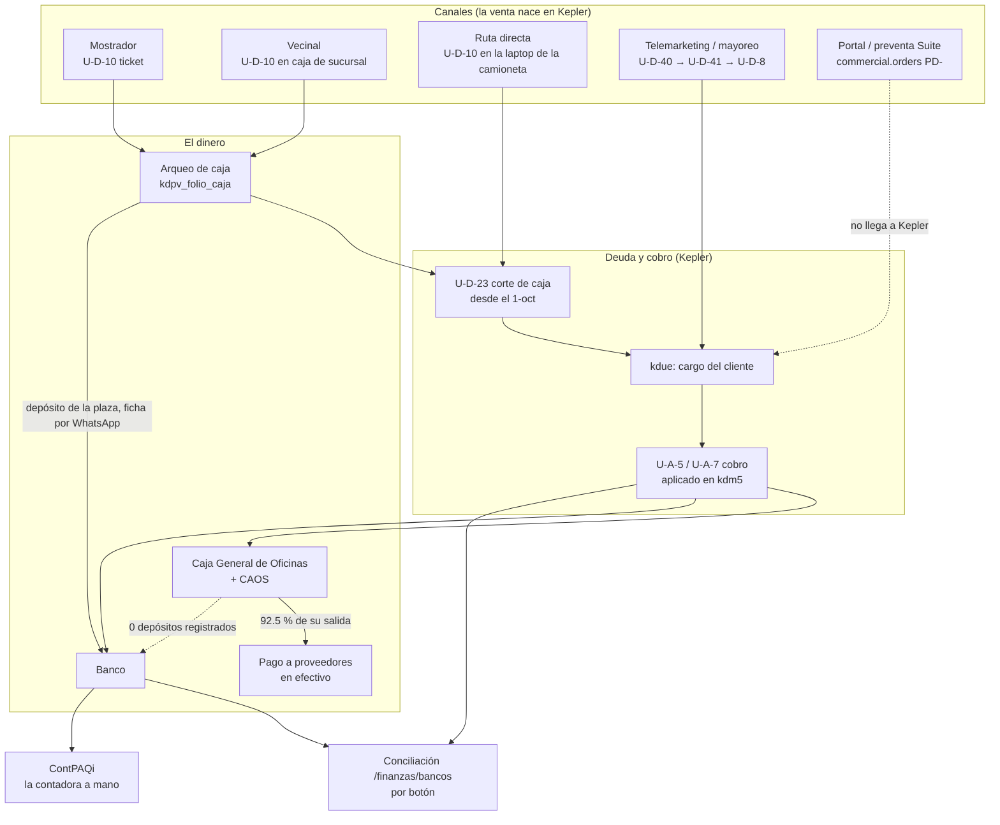

# De la venta al cobro — el flujo completo

> **Qué contesta:** qué pasa, en qué orden, quién lo hace, en qué sistema y qué documento queda,
> desde que se toma un pedido o se vende en mostrador hasta que el dinero está cobrado, en el banco,
> conciliado y contabilizado. Y en cada paso, **hasta dónde se puede seguir un peso** y dónde se rompe.
> Es el espejo de [`FLUJO_COMPRA_A_PAGO.md`](FLUJO_COMPRA_A_PAGO.md).
>
> ⛔ **Qué NO contesta:** cómo se fija el precio ([`VERDAD_ABSOLUTA.md`](VERDAD_ABSOLUTA.md) §precios), cuál
> es «la venta» para reportar (eso lo arbitra `analytics.mv_kepler_sales_daily`, VERDAD §sell-out) ni el
> pago a choferes ([`FASE_EMB_PAGO_POR_VIAJE`](IMPLEMENTACION/FASES/FASE_EMB_PAGO_POR_VIAJE.md)).
>
> **Corte: 2026-10-26.** Las cifras sin fecha se midieron ese día contra producción (`pg-prod`,
> `system_identifier 7688376744939610156`), en sólo lectura, a las 15:18. **Universo:** documentos de
> Kepler con fecha `c9` del 2026-01-01 al 2026-10-25, propios (`c1 = sucursal`) y de camioneta
> (`c1 = sucursal-NNN`), sin réplicas (2,435) ni cancelados (7,838). Cada partición cuadra contra su
> total y cada liga se probó contra un placebo. Las cifras con otra fecha vienen del doc de fase citado;
> la deducción se marca **INFERIDO**.
>
> **«Oficinas»** es el servidor central de Kepler (el sistema lo rotula «CEDIS»). **«Sucursales»** son
> las otras ocho plazas. ⚠️ **En 2026 conviven dos modelos** (§2, punto 2): hasta el 30-sep Oficinas
> concentraba la venta y el cobro de todas; desde el 1-oct cada sucursal cierra lo suyo. Una cifra del
> año entero mezcla los dos.

**Contenido:** §1 [El flujo en una pantalla](#1-el-flujo-en-una-pantalla) · §2 [Lo que dice la medición](#2-lo-que-dice-la-medición) · §3 [Volumen 2026](#3-volumen-2026) · §4 [Paso a paso](#4-paso-a-paso) · §5 [Las ligas](#5-las-ligas-hasta-dónde-se-puede-seguir-un-peso) · §6 [Tiempos](#6-tiempos) · §7 [Lo que está roto](#7-lo-que-está-roto-ordenado-por-dinero-en-riesgo) · §8 [Decisiones abiertas](#8-decisiones-abiertas) · §9 [Lo que NO se midió](#9-lo-que-no-se-midió) · §10 [Docs desactualizados](#10-docs-que-quedaron-desactualizados) · §11 [Dónde mirar y cómo re-medir](#11-dónde-mirar-y-cómo-re-medir)

---

## 1. El flujo en una pantalla

La compra tiene **una** cadena. La venta tiene **cinco canales**, cada uno con sus documentos, y todos
terminan en el mismo lugar: un cobro de Kepler (`U-A-5` «Cobro PUE» o `U-A-7` «Cobro CFDI») que salda
la deuda, y un dinero que tiene que llegar al banco y a la contabilidad.

| Canal | Quién vende | Documento de venta | Cómo se cobra | Dónde cae el dinero |
|---|---|---|---|---|
| **Mostrador** | Cajera de sucursal | `U-D-10` ticket (y su comprobante `U-D-5`, el espejo `U-D-12` o la factura global `U-D-6`) | contado, en el acto; desde el 1-oct el turno cierra con un corte `U-D-23` que salda un `U-A-5` | depósito de la plaza al banco, o efectivo a Caja General |
| **Vecinal** | Vendedor vecinal (preventa en la app o en papel); timbra la cajera | `U-D-10` en una caja de la sucursal, con vendedor `1V00x` en `c12` | contado, en el arqueo de **esa** caja | igual que mostrador |
| **Ruta directa** (13 rutas) | Vendedor de ruta + chofer | `U-D-10` en el Kepler de la laptop de la camioneta | el chofer entrega el efectivo en Caja General; `U-A-5` a la cuenta `0011` | Caja General / CAOS |
| **Telemarketing / mayoreo** | Operadores de telemarketing en Kepler | `U-D-40` pedido → `U-D-41` embarque → `U-D-8` factura (CFDI) | a crédito; transferencia o depósito → `U-A-7` o `U-A-5` | banco |
| **Portal y preventa de la Suite** | Cliente o vendedor | `commercial.orders` (`PD-…`) | no cobra en Kepler | — (52 pedidos en total, 2026-10-21) |

⛔ **Ningún pedido de venta de ningún canal se escribe a Kepler desde la Suite.** La única escritura
Suite → Kepler (Fase KR) es de compra y traspaso, y está apagada desde el 2026-10-26. La venta nace y se
cobra en Kepler; la Suite la **lee** del ODS, salvo la de las camionetas, que llega por su envío.

---

## 2. Lo que dice la medición

1. **Telemarketing es la cadena más sólida.** Pedido → embarque 100 %, embarque → factura 99.9 %,
   factura → cobro 99.8 % (placebo 10–30 %). Del pedido al último cobro pasa **1 día** de mediana (p90
   35), y de las facturas de ene–ago está cobrado el **87.4 %** del monto.
2. **Hasta el 30-sep, Oficinas era la caja de todos.** La venta de cada plaza llegaba como una factura
   `U-D-13` a la cuenta de la plaza y se saldaba con un `U-A-5` en Oficinas: **$496.9M de `U-D-13` en
   Oficinas, 86–99.7 % a cuentas de la casa** (plazas `NN-00`, escritorios de telemarketing, rutas).
   Desde el 1-oct cada plaza cierra su corte y lo cobra ella: los `U-A-5` de sucursal pasan de 53 en
   ene–sep a **1,191 ($22.53M) sólo en octubre**, y la `U-D-13` de Oficinas cae a $1.65M.
3. ⭐ **La cartera de Oficinas probablemente cobra dos veces $18.4M.** De jul–sep hay 1,992 facturas
   `U-D-13` a clientes de afuera ($22.67M) y el **90.1 %** tiene una factura `U-D-8` de la sucursal al
   mismo cliente, ±$1 y ±3 días (placebo 0.3 %): son **espejo**, no venta adicional. Esas facturas
   espejo suman hoy **$18.38M** de saldo, y 219 de esos clientes pagaron $8.18M en su sucursal desde el
   1-oct, todo aplicado a la `U-D-8`. **INFERIDO** con evidencia fuerte; lo tiene que confirmar el negocio.
4. **La cartera viva es de $65.58M y el 89.6 % está vencido.** Pero $24.36M son 5 cuentas internas de la
   casa (100 % vencidas) y de los $38.90M de clientes de afuera, $18.38M son las facturas espejo. La deuda
   real de terceros podría rondar **$20.5M** (INFERIDO, depende del punto 3).
5. **En mostrador nadie sabe con qué pagó el cliente** (efectivo o tarjeta): la cuenta `c45` viene vacía
   en el 100 % de los 526,709 tickets ($145.13M). Y el arqueo de Kepler no es un conteo: el «contado» es
   igual al «esperado» al centavo en el **75.8 %** de los cortes.
6. ⭐ **El efectivo cobrado casi no llega al banco.** En el libro de Caja General **0 de 250** movimientos
   son depósitos; el **92.5 %** de lo que sale de ahí son pagos a proveedores en efectivo (`X-D-26`,
   $77.5M). Es el mismo dinero que en [compra → pago](FLUJO_COMPRA_A_PAGO.md) sale como efectivo sin póliza.
7. **El registro de cobros a Caja General se cayó el 12-oct** (de 90–115 `U-A-5` por semana a 3) y la
   causa no se ha encontrado (D1 de la fase CGA). Los cobros de camioneta no llegan al ODS por la vía
   normal, y las camionetas de Canindo no tienen corte `U-D-23`.
8. **Sólo el 46 % de los cobros depositados en banco está conciliado.** El conciliador se corre con un
   botón, y en febrero y de abril a junio casi nadie lo apretó (0–7 %); de julio a septiembre, 87–94 %.
9. **La contabilidad del ingreso se teclea a mano** y la Suite no arma nada de ese lado. A ContPAQi
   llegan 6 puntos de venta: $17–18M al mes contra $52–58M en Kepler (2026-10-08). La cartera de Kepler
   ($30.7M de clientes reales) contra la cuenta de clientes de ContPAQi ($9.1M): 3.4×, sin cuadre.
10. **La entrega al cliente no se puede probar:** **0 de 2,545** paradas de los últimos 90 días tienen un
    cierre verificable, y el 71 % de los viajes a cliente no dice quién era el chofer (2026-10-15).

---

## 3. Volumen 2026

| Documento | Kepler | Docs | $M | Nota |
|---|---|---:|---:|---|
| Pedido | `U-D-40` | 9,665 | 155.47 | telemarketing y pedido de sucursal (traspaso) |
| Embarque | `U-D-41` | 8,294 | 150.20 | serie 1 telemarketing 4,619 / $37.16M · serie 2 a sucursal 3,675 / $113.04M (traspaso, al costo) |
| Factura telemarketing | `U-D-8` | 4,594 | 36.97 | 99.9 % a clientes de afuera |
| Ticket de mostrador | `U-D-10` | 526,709 | 145.13 | de camioneta: 8,725 / $5.38M |
| Corte de caja | `U-D-23` | 825 | 31.86 | existe sólo desde el 2026-09-30 |
| Factura crédito no fiscal | `U-D-13` | 8,668 | 497.13 | Oficinas: 8,621 / $496.93M (ver abajo) |
| Factura contado no fiscal | `U-D-12` | 5,675 | 8.97 | espejo del ticket, no venta |
| Factura global · factura de ticket | `U-D-6` · `U-D-5` | 1,527 · 9,566 | 125.85 · 8.59 | comprobantes de los tickets |
| **Cobro PUE** | `U-A-5` | **25,834** | **495.66** | Oficinas: 24,590 / $471.99M |
| **Cobro CFDI** | `U-A-7` | **2,721** | **21.99** | todos subtipo 1 |

- **A quién va la `U-D-13` de Oficinas:** cuentas de la casa (`NN-NN`) $410.51M (82.6 %) · rutas $61.39M
  (12.3 %) · clientes de afuera $24.77M (5.0 %). Los cinco mayores son plazas propias: Morelia Abastos
  (punto de venta) $105.12M, Canindo $47.85M, Padre Hidalgo piso $44.90M, el escritorio de telemarketing
  de Morelia Abastos $43.37M y 8 Esquinas $43.36M. **Ninguna** va a un cliente `TI…` (sucursal propia):
  ésos viven en `U-D-40`/`U-D-41`.
- ⛔ **Estos montos no se suman como «venta».** El ticket, su factura, su espejo y su factura global son
  el mismo dinero; el embarque a sucursal es traspaso; la `U-D-13` interna es la plaza facturándose en
  Oficinas. La venta neta a terceros **no se midió aquí**: la arbitra `mv_kepler_sales_daily`.

---

## 4. Paso a paso

### 4.1 Canales y toma del pedido

| Canal | Dónde se toma | En la Suite hoy | Huecos medidos |
|---|---|---|---|
| Mostrador | caja de Kepler (una por terminal; la caja es el subtipo del doctype y parte de la llave) | lectura: tickets, Cortes/Sucursales, sell-out | medio de pago desconocido (`c45` vacío) |
| Vecinal | app del vendedor de la Suite (preventa `PD-`) o papel; la cajera la vuelve a teclear en Kepler | mesa de preventa (MCP, mayormente 🧪) | **doble captura**: lo cobrado sale 8–22 % por debajo de lo pedido; 27 preventas confirmadas, las 27 vencidas, 7 ya cobradas en Kepler sin que la Suite lo supiera (2026-10-08) |
| Ruta directa | Kepler local de la laptop; la carga sale como pedido de sucursal → `U-D-41-2` al costo | inventario y ventas de ruta, sólo lectura; el envío corre cada 15 min | 11 camionetas suben venta y 4 suben cobros (2026-10-16); el filtro anti-réplica descartaba $5.87M en 90 días (2026-10-14) |
| Telemarketing | Kepler (pantalla de telemarketing), 4 operadores | tablero de facturación; surtido sin papel (GP) en código | la toma de pedido de la Suite nunca se usó (0 llamadas); 26 cotizaciones, 0 convertidas (2026-10-21) |
| Portal / app | `commercial.orders` (`PD-`) | en prod | 52 pedidos en total; ⚠️ `fulfill` descuenta inventario propio y timbra CFDI: si el cobro va por Kepler, **duplica la venta** |

- **Precio y descuento:** el precio cobrado es `kdm2.c12` (por unidad base, con impuestos). El descuento
  del cliente es `kdud.c17`, que Kepler copia a la cabecera y aplica al total; en septiembre 45 de 578
  documentos salieron sin él. **La Suite lo aplica en 1 de 5 flujos** (sólo Cotizaciones).

### 4.2 Surtido, checado, embarque y entrega (telemarketing)

| Paso | Quién | Kepler / papel | Liga | En la Suite |
|---|---|---|---|---|
| Pedido autorizado | operador; quién autoriza **no está documentado** | `U-D-40`, estatus en `c11`: CREADO → AUTORIZADO → SURTIDO → CHECADO → EMBARCADO | — | `/almacen/pedidos` (GP.1) |
| Surtido | almacenista; Facturación cambia el estatus en Kepler | ticket impreso, cantidad a pluma; renglón `c52` | `c51` pedida → `c52` surtida | `/almacen/surtir` (GP.3): **0 olas en prod** (2026-10-08) |
| Checado | siempre otra persona | ticket «CHECADO», bultos a mano | `c53` | `/almacen/checar` (GP.4): 0 checados al aplicarse (2026-10-09) |
| Embarque | embarcador; la Suite no ve quién carga | `U-D-41` serie 1; `c86` guía = el viaje | `c37='40'` + `c39` = folio del pedido | GP.5 ⬜ |
| Factura | Facturación | `U-D-8` (CFDI) | `c37=41` + `c39` | control «embarcado contra facturado» (CXC.19): 7 casos por $52,950 (2026-08-31) |
| Viaje | chofer y ayudantes de Logística | hoja de viaje **a mano** | guía → transporte → placa → GPS | Fase HV ⬜; 31.7 % de los viajes con rastro GPS |
| **Entrega** | chofer | **no hay documento**; la remisión firmada queda en papel | — | cierre de parada en Logística; la foto quedó opcional el 12-oct |

- La factura sale **15–25 minutos después del embarque**, antes de salir del almacén: no prueba entrega.
- **Ruta directa no tiene documento de retorno**: lo que regresa en la camioneta no deja rastro; el
  inventario de ruta se reconstruye como cargado − vendido y sólo hubo 1 conteo físico en 180 días
  (2026-06-26).

### 4.3 El documento de venta y la deuda del cliente

- **Qué es cargo en la cartera** (`kepler_ods.kdue`, `c29='C'`), por tipo: 3 factura TK crédito · 8 factura
  telemarketing · 9 ticket crédito · 12 · 13 factura crédito no fiscal · 25 cheque devuelto · 41 embarque
  (sólo en La Piedad Abastos, donde el embarque ES el cargo). Fuera, por ser contado: 10 ticket, 5 factura
  TK contado y 23 corte (ése lo lee Cortes/Sucursales).
- **Saldo del cliente** = Σ `kdue.c11` con signo (cargo +, abono −); vencimiento `c10` = fecha + días de
  crédito `c9` en el 96 %. ⚠️ El estado y saldo de la cabecera (`kdm1.c43`/`c42`) van rezagados: en 563
  de 1,346 facturas de telemarketing decían que se debía todo cuando ya estaban cobradas. **Manda `kdue`.**
- **Crédito:** límite `kdud.c15`, días `c16`, descuento `c17`. **Quién autoriza un crédito y fija el
  límite no está documentado**: vive en Kepler. **La Suite no frena por crédito** (cero referencias en
  los pedidos de la Suite), aunque un doc de fase dice lo contrario.
- ⚠️ La cartera une el catálogo de clientes sólo por clave, y la clave `00002` son cuatro clientes
  distintos según la plaza: límite, teléfono y nombre pueden salir de otro cliente (NO MEDIDO).

### 4.4 Devoluciones y notas de crédito

- **Mostrador:** `U-A-21` (fiscal) y `U-A-25` (no fiscal) se aplican a la **factura que nace del ticket**,
  nunca al ticket, por `c36`–`c39`: encontraron su factura 189 de 189 y 475 de 475 en 2026. Las
  devoluciones pagadas en caja se restan del corte (con el esperado neto cuadran 184 de 196 cortes).
- **Telemarketing:** 10 notas o devoluciones en 45 días (2026-10-09). **Ruta directa:** sin documento.
- **Lo que no las resta:** la venta vecinal publicada no descuenta sus notas ($99,908, 1.41 %, 2026-10-15),
  y las notas sin documento origen no se ligan (Yurécuaro, 2026: 128).

### 4.5 El cobro, por canal

| Canal | Quién cobra · documento | Medido |
|---|---|---|
| Mostrador | la cajera, en el acto; desde el 1-oct el corte `U-D-23` lo salda un `U-A-5` aplicado al corte | cortes de tienda con cobro: **72–89 %** según la sucursal, mediana 1–4 días (desde el 30-sep) |
| Ruta directa | el chofer entrega en Caja General; `U-A-5` a la cuenta `0011` (99.7 % efectivo) | Padre Hidalgo: 115 cortes / $2.02M, **99.1 %** con cobro, mediana 1 día (vía `analytics.route_collections`). Canindo: cobros sin ningún corte en Kepler |
| Vecinal | contado en caja; lo a crédito, `U-D-8` → cobro | ago–oct: 39 facturas / $306,686.88, **$128,053.43 sin cobrar** (2026-10-15) |
| Telemarketing / mayoreo | el cliente transfiere y avisa por WhatsApp; Crédito y Cobranza aplica `U-A-7` o `U-A-5`; el vendedor cobra con la guía de cobranza impresa | 87.4 % de lo facturado ene–ago ya cobrado; 138 guías por $21.38M (11-sep → 26-oct) |
| Portal | no cobra (no hay pasarela) | — |

**Dónde cae el cobro** (`c45` contra el catálogo de cuentas `kdb1`; 28,555 cobros, $517.65M):

| | Banco | Caja (todo Caja General `0011`) | Otro |
|---|---:|---:|---:|
| `U-A-5` | 22,017 / $417.74M (84.3 %) | 3,675 / $76.76M (15.5 %) | 142 / $1.06M |
| `U-A-7` | 1,493 / $21.22M (96.5 %) | — | 1,228 / $0.77M con `c45='PESOS'` (no es cuenta; casi todo La Piedad Abastos) |

⚠️ **`c45` dice dónde se depositó, no cómo pagó el cliente:** de los `U-A-7` depositados en banco, el
complemento del SAT dice «01 efectivo» en 996 ($15.52M).

### 4.6 Aplicación del cobro y cartera

- **La aplicación** vive en `kepler_ods.kdm5`: quién aplica en `c2`–`c6`, a qué en `c1`/`c8`–`c11`, monto
  en **`c13`**; se lee `analytics.kepler_kdm5_vigente` (sin cancelados: 352 aplicaciones, $6.97M). El
  `U-A-5` salda en un 98 % facturas `U-D-13`. Abonos que ningún documento absorbe: $3.06M (2026-09-24).
- **Cobro del crédito** (cargos de ene–ago, ya maduros, 12,140 por $461.09M; segunda implementación
  igual al centavo en los 12,140):

  | Grupo | $M | Cobrado | Días del vencimiento al cobro (mediana · p90) | A tiempo |
  |---|---:|---:|---|---:|
  | `U-D-13` a cuentas de la casa | 377.78 | 93.9 % | 5 · 49 | 5.3 % |
  | Rutas | 54.92 | 96.9 % | 1 · 5 | 28.5 % |
  | **`U-D-8` a clientes de afuera** | 13.04 | **87.5 %** | −1 · 25 | 62.3 % |
  | **`U-D-13` a clientes de afuera** | 13.15 | **18.5 %** | 1 · 13 | 49.8 % |
  | `U-D-12` | 5.91 | 51.1 % | 33 · 182 | 31 % |

  El 18.5 % de la fila resaltada es la huella del espejo (§2, punto 3): esas facturas no se cobran porque
  el cliente paga la otra.
- **Cartera viva hoy** (la misma regla que `/finanzas/cartera`; cuadra con `kdue` directo a $0 en las 9
  sucursales):

  | Sucursal | Saldo $M | Por vencer | 1–30 | 31–60 | 61–90 | >90 | Vencido |
  |---|---:|---:|---:|---:|---:|---:|---:|
  | Oficinas | 48.49 | 0.10 | 6.47 | 14.05 | 12.89 | 14.67 | 99.8 % |
  | Padre Hidalgo | 6.99 | 2.06 | 2.40 | 1.45 | 0.80 | 0.29 | 70.6 % |
  | Morelia Abastos | 4.74 | 2.75 | 1.92 | 0.07 | 0 | 0 | 42.0 % |
  | Canindo | 4.06 | 1.86 | 1.57 | 0.58 | 0.05 | 0 | 54.2 % |
  | La Piedad Abastos | 0.72 | 0 | 0 | 0 | 0 | 0.72 | 100 % |
  | Morelia Madero, Zamora Centro, Yurécuaro, 8 Esquinas | 0.58 | | | | | | |
  | **Total** | **65.58** | 6.77 | 12.45 | 16.61 | 13.74 | 15.69 | **89.6 %** |

  ⚠️ Las columnas de antigüedad suman **$65.26M**: $0.32M del saldo no tiene documento al que asignarle
  fecha (por qué, NO MEDIDO). El 89.6 % vencido es sobre lo que sí tiene fecha: **$58.49M**.

  Por tipo: clientes de afuera $38.90M (de ellos $21.96M en Oficinas, 311 clientes, y $18.38M en
  facturas espejo) · 5 cuentas internas $24.36M. ⚠️ El «saldo a favor» de la cuenta CONTADO (−$23.58M)
  es un artefacto: la vista excluye los cortes como cargo pero cuenta los cobros que los saldan.
- **La pantalla** `/finanzas/cartera` (Crédito y Cobranza, 3 personas): saldo, aging, detalle por cliente,
  promesas, WhatsApp prellenado. Tarda **4.2 s** (la regla es 1 s). Su uso real **NO MEDIDO**.
- **La gestión no existe:** el detector de las 08:30 marcó 680 clientes vencidos y 269 sobre su línea,
  **0 atendidos en 30 días** (2026-09-22); promesas de pago y fichas de depósito en la Suite: **0 filas**.

### 4.7 El efectivo: arqueo, corte, Caja General y CAOS

- **Mostrador:** entre el 63 % y el 81 % del efectivo sale en sangrías antes del cierre (2026-09-03). El
  arqueo de Kepler (`kdpv_folio_caja` → `analytics.cash_cuts`, 4,480 cortes en 2026): esperado $126.44M,
  contado $125.82M; sin los 36 cortes con contado en cero, **faltante neto $244,934 y 6.2 % de cortes con
  diferencia ≥ $50** (peor: Zamora Centro, 9.2 %). El conteo ciego de la Suite (`/tienda/arqueo`) no se
  hace: 76 de 78 cortes sin él (2026-09-03).
- **Corte `U-D-23`:** el monto es lo que **contó** la cajera, no lo que vendió. Desde el 1-oct.
- **Camioneta:** los billetes entran a CAOS con un usuario genérico compartido por todas las rutas; quién
  depositó queda en una referencia de texto libre. 603 depósitos por $13.1M desde el 27-may (2026-10-23).
- **Caja General de Oficinas:** las cajeras registran el `U-A-5` (cuenta `0011`, póliza 102 / 115) y la
  Suite lo lleva al libro (`finance.cash_ledger`, autollenado cada 15 min). El `U-A-5` es el 95 % de su
  entrada. **Sale** en un 92.5 % a pagos a proveedores en efectivo. Corte diario: 7 cerrados, **0
  autorizados**, 4 con un «debería haber» negativo de hasta −$149,915.32 (2026-10-21).
- **CAOS** (caja fuerte de Oficinas): por ahí pasa ~40 % del efectivo de `0011`; 30 de 409 retiros ligados
  a un gasto. ⚠️ La clave de fábrica sigue activa (2026-10-20): hallazgo de seguridad.

### 4.8 Depósito y conciliación bancaria

- **Lo que sí va al banco** es la venta de mostrador de las plazas: el encargado deposita, manda la foto
  de la ficha por WhatsApp y Tesorería la teclea al libro de bancos. No hay liga con el corte (CSU.3 ⬜).
  La captura por WhatsApp de la Suite (CBW) tiene 106 remitentes y **0 capturas**.
- **Caja General no deposita:** 0 de 250 movimientos del libro; $948,010 de vaciados de CAOS sin destino
  declarado (2026-10-13/14). Decidir qué se hace con ese efectivo es D7 (Edgar).
- **Conciliación** (`finance.bank_recon_matches`, liga estructural, importe igual en 99.5 %, placebo 0.5 %):

  | Cobros 2026 | Conciliados con banco |
  |---|---:|
  | `U-A-5` depositados en banco | 10,119 de 22,017 (46.0 %) |
  | `U-A-5` en caja | 1,412 de 3,675 (38.4 %) |
  | `U-A-7` | 1,162 de 1,493 (77.8 %) |

  Por mes: enero 62 %, febrero 3 %, abril–junio 0–7 %, julio–septiembre 87–94 %. 314 conciliaciones
  apuntan a cobros cancelados. Abonos del banco sin cobro en Kepler: 5,244 por $118.9M históricos, 1,824
  abiertos (~2026-09-24).

### 4.9 Contabilidad y SAT

- **Kepler** asienta su póliza del cobro (102 / 115). **ContPAQi** lo vuelve a teclear la contadora: la
  póliza mensual «VENTAS ‹sucursal›» es en realidad de cobranza (un renglón por depósito), y la venta va
  diaria aparte. Llegan 6 puntos de venta. **La Suite no arma nada del ingreso** (CPA.9 ⬜).
- **Factura global** `U-D-6`/`U-D-7`: la emite Kepler y la timbra el PAC; refactura ~90 % de los tickets
  ($116.4M en 2026).
- **CFDI emitidos:** 261,420 cargados a `fiscal.cfdis` (2026-10-05); la carga continua sólo está en un PR
  sin mergear. La e.firma para la descarga del SAT venció el 2026-07-27. **$70.4M (14.9 %) de venta sin
  CFDI** y 1,065 CFDI sin asociar en contabilidad por $13.5M, sin explicar (2026-10-05/10).

---

## 5. Las ligas: hasta dónde se puede seguir un peso

| Tramo | Cómo se liga | Tipo | Cobertura | Fecha |
|---|---|---|---|---|
| Pedido Suite → Kepler | ninguna (no se escribe) | **no existe** | preventa ligada a mano | 10-08 |
| Embarque → pedido (telemarketing / sucursal) | `c37`/`c39` del hijo | estructural | 100 % · 100 % (placebo 14–30 %) | hoy |
| Factura telemarketing → embarque | `c37`/`c39` | estructural | 4,592 de 4,594 | hoy |
| Factura / espejo / factura global → ticket | `c36`–`c39` | estructural | 9,383 de 9,391 (`U-D-5`) · 4,412 de 4,412 (`U-D-12`) | 2026 |
| Factura → entrega al cliente | — | **no existe** | 0 de 2,545 paradas verificables | 10-15 |
| Cobro CFDI → factura | `kdm5` | estructural | 99.8 % (placebo 10.5 %) | hoy |
| Cobro de tienda → corte | `kdm5` | estructural | 72–89 % de los cortes | hoy |
| Cobro de camioneta → corte | `analytics.route_collections` (envío) | estructural, fuera del ODS | Padre Hidalgo 99.1 % · Canindo sin corte | hoy |
| Factura espejo de Oficinas ↔ factura de sucursal | cliente + importe ±$1 + ±3 días | **heurística** | 90.1 % (placebo 0.3 %) | hoy |
| Ticket → medio de pago | `c45` | **vacía** | 0 % | hoy |
| Arqueo → conteo real | contado vs esperado | declarado | igual al centavo en 75.8 % | 09-03 |
| Depósito de plaza → corte | — | **no existe** | ficha por WhatsApp | — |
| Cobro → banco | conciliación por botón | estructural | 46 % de los `U-A-5` a banco | hoy |
| Cartera Kepler ↔ ContPAQi | — | **no existe** | $30.7M vs $9.1M | 09-24 |

**La lectura:** dentro de Kepler, telemarketing y los comprobantes del ticket se ligan casi completos.
Lo que se pierde está en las orillas: la entrega, el medio de pago, el depósito, la conciliación y la
contabilidad. Y del lado del cobro, la cartera de Oficinas trae una copia de la de las sucursales.

---

## 6. Tiempos

| Tramo (telemarketing, pares ligados) | Mediana | p90 | Mismo día |
|---|---:|---:|---:|
| Pedido → embarque | 0 | 1 | 80.8 % |
| Embarque → factura | 0 | 0 | 95.8 % |
| Factura → último cobro (facturas ene–ago) | 2 | 39 | — |
| Pedido → último cobro (2,030 cadenas saldadas) | 1 | 35 | — |

- Corte de tienda → cobro: mediana 1–4 días, p90 3–10. Corte de camioneta → cobro: mediana 1, p90 3.
- La fecha del cobro en Kepler es el día del tecleo: la fecha real del `U-A-7` está en el complemento SAT,
  y en Padre Hidalgo difiere en el 97.8 % (6.8 días de promedio).

---

## 7. Lo que está roto, ordenado por dinero en riesgo

| # | Qué pasa | Dinero | Qué lo arregla |
|---|---|---|---|
| 1 | **Cartera inflada:** facturas espejo de Oficinas (jul–sep) que el cliente ya paga en su sucursal, más 5 cuentas internas, ambas «vencidas» y en la cola de cobranza | **$18.38M** espejo · **$24.36M** internas | decidir si las espejo se cancelan y si las internas son cartera (§8) |
| 2 | **El efectivo no tiene camino al banco:** Caja General no deposita, recicla en pagos a proveedores | ~$77.5M de salida en efectivo; $948,010 de CAOS sin destino | D7 + dictamen de Contabilidad (es el mismo hueco de compra → pago) |
| 3 | **El cobro se cae:** registro a Caja General caído desde el 12-oct; camionetas de Canindo sin corte; cortes de tienda 11–28 % sin cobro | $2.98M de cortes sin cobro en Padre Hidalgo (2026-10-16) | D1 en la fase CGA; carril de cobro de cada camioneta |
| 4 | **Vencido sin gestión:** 89.6 % de la cartera vencida, 0 clientes atendidos, 0 promesas | $58.49M vencidos (incluye los del punto 1) | depurar la cartera (punto 1) y asignar la cola |
| 5 | **Conciliación a medias:** 46 % de los cobros a banco; meses sin correr | 1,824 abonos abiertos; $118.9M históricos sin cobro | encender el disparo automático (CB.53) |
| 6 | **La contabilidad no cuadra:** 6 puntos de venta en ContPAQi, cartera 3.4× la balanza, 14.9 % de venta sin CFDI | $70.4M sin CFDI | póliza de ingreso armada (CPA.9) + e.firma |
| 7 | **Mostrador opaco:** medio de pago desconocido; arqueo declarado, no contado | faltante neto $244,934 en 2026 | conteo ciego obligatorio; capturar el medio |
| 8 | **La entrega y el chofer no se prueban** | afecta el pago por viaje (se reproduce 25 % de la comisión pagada, 2026-10-26) | Fase HV |
| 9 | **Doble captura de preventa** y riesgo de duplicar venta con el portal | 8–22 % de diferencia pedido-cobrado | ligar el pedido al ticket (MCP) |

---

## 8. Decisiones abiertas

| # | Pregunta | Quién contesta |
|---|---|---|
| 1 | Las facturas `U-D-13` espejo de Oficinas (jul–sep, $18.38M de saldo), ¿se cancelan? | Contabilidad / Crédito y Cobranza |
| 2 | Las 5 cuentas internas ($24.36M), ¿son cartera o se sacan de la cola? | Finanzas |
| 3 | D7: el efectivo de Caja General, ¿se deposita o se sigue usando para pagar proveedores? | Dirección / Contabilidad |
| 4 | ¿Quién autoriza un crédito y su límite? ¿La Suite debe frenar un pedido por crédito? | Crédito y Cobranza |
| 5 | ¿Quién corre la conciliación y cada cuánto? ¿Se enciende el disparo automático? | Tesorería |
| 6 | ¿Se automatiza la póliza de ingreso (CPA.9)? ¿Quién la importa en ContPAQi? | Contabilidad |
| 7 | ¿Se renueva la e.firma para la descarga del SAT? | Contabilidad |

---

## 9. Lo que NO se midió

- **La venta neta a terceros del año:** no se sumó a propósito (§3); la arbitra `mv_kepler_sales_daily`.
- **Si `U-D-6` y `U-D-5` son siempre el CFDI de la misma venta** (lo más probable) y el espejo `U-D-12` se
  re-midió con 2026 completo sólo por su liga al ticket.
- **Mostrador antes de que cada sucursal pasara a Kepler** (va del 2-ene en La Piedad Abastos al 19-sep en
  Morelia Abastos) y los cortes antes del 30-sep: no existen en Kepler.
- **El cobro de camioneta** en Kepler aparece sólo en 0–16 % de los casos; se midió por el envío.
- **Por qué hay 5,560 `U-A-5` cancelados** (17.7 %) y si las 45 aplicaciones a cortes cuyo folio también
  existe como corte de ruta son colisiones.
- **Si el vencimiento de las cuentas internas es un plazo real**, el uso real de `/finanzas/cartera`, si el
  detector de cartera está encendido en prod, y cómo se autoriza un crédito.

---

## 10. Docs que quedaron desactualizados

| Doc o archivo | Qué dice | Qué es hoy |
|---|---|---|
| [`ERP_KEPLER.md`](ERP_KEPLER.md) §cobros · [`VERDAD_ABSOLUTA.md`](VERDAD_ABSOLUTA.md) §18.10 · ADR-095 | `U-D-13` es «cobro de ruta» / «traspaso» / «venta a crédito» | depende del periodo: hasta el 30-sep, 86–99.7 % cuentas de la casa en Oficinas; además, espejo de `U-D-8` en jul–sep |
| `VERDAD_ABSOLUTA.md` §18.10 | «no hay CFDI emitido» | 261,420 cargados (2026-10-05) |
| `VERDAD_ABSOLUTA.md` (cobro real ~$53.3M/mes) vs `FASE_CG_CIRCUITO_DEL_EFECTIVO` (82 % interno) | dos lecturas de la cobranza mensual | arbitrar antes de citar cualquiera |
| [`CAOS_CASH_SYSTEM.md`](CAOS_CASH_SYSTEM.md) y memoria | «CAOS es la Caja General `0011`» | son dos cajas; por CAOS pasa ~40 % |
| `FASE_E_REMOTE_MANAGER` | la Suite valida el crédito | no lo valida |
| `FASE_CC_COMPROBANTES_COBRANZA` · roadmap de `CLAUDE.md` | importer, `md_00`, Railway; fase ⏸️ | vista viva de todas las sucursales; ítems ✅/🚀 |
| `FASE_CXC_CARTERA_CLIENTES` y `customer-ledger.service.ts:76,88` | migraciones «pendientes en Railway», cifras de Railway | aplicadas en `md`; cifras de hoy en §4.6 |
| `FASE_GP` §4 · `FASE_VR` | catálogos de responsables fuera del ODS · «2 camionetas» | sí están · 11 camionetas |
| `FASE_TK_TICKETS_VENTA` | descuento de cabecera en 0 en el 100 % | medido en la base de prueba; en prod hay tickets con 3 % |
| [`GLOSSARY.md`](GLOSSARY.md):23 | «canal RD por `kdm1.c6`» | `c6` es el folio |
| `CLAUDE.md` roadmap | sin fila para CXC, VK ni DC | — |

---

## 11. Dónde mirar y cómo re-medir

**Para re-medir (seguimiento mensual):**
`node database/scripts/medir-flujo-venta-a-cobro.js --desde 2026-01-01 --hasta 2026-10-25 --maduro 2026-08-31 --json <ruta>`
reproduce las cifras de este doc (secciones sueltas: `… 4 7`). Sólo lectura; aborta si el destino no es
prod. ⚠️ Kepler captura con fecha pasada: la misma ventana puede moverse unos documentos entre corridas.

| Para | Archivo |
|---|---|
| Decode de documentos de venta y cobro | [`ERP_KEPLER.md`](ERP_KEPLER.md) (índice: ventas, cobros, `kdue`, `kdm5`, `c45`/`kdb1`) |
| Qué arbitra cada número | [`VERDAD_ABSOLUTA.md`](VERDAD_ABSOLUTA.md) (índice: sell-out, cartera, caja) |
| Cartera | [`FASE_CXC`](IMPLEMENTACION/FASES/FASE_CXC_CARTERA_CLIENTES.md) · `libs/finance/src/lib/customer-ledger/` · `database/migrations-newdb/20260905150000_erp_receivable_documents_core.js` |
| Cortes y Caja General | [`FASE_CSU`](IMPLEMENTACION/FASES/FASE_CSU_CORTES_SUCURSALES.md) · [`FASE_CGA`](IMPLEMENTACION/FASES/FASE_CGA_PLAN_IMPLEMENTACION.md) · [`CAJA_GENERAL_OPERACION`](IMPLEMENTACION/RUNBOOKS/CAJA_GENERAL_OPERACION.md) |
| Surtido, embarque y entrega | [`FASE_GP`](IMPLEMENTACION/FASES/FASE_GP_GESTION_PEDIDOS_ALMACEN.md) · `FASE_HV_HOJA_DE_VIAJE.md` (en preparación, todavía sin commitear) |
| Conciliación | [`FASE_CB`](IMPLEMENTACION/FASES/FASE_CB_CONCILIACION_BANCARIA.md) · `libs/finance/src/lib/bank/finance-bank.service.ts` |
| El otro lado del efectivo | [`FLUJO_COMPRA_A_PAGO.md`](FLUJO_COMPRA_A_PAGO.md) §4.10 |
