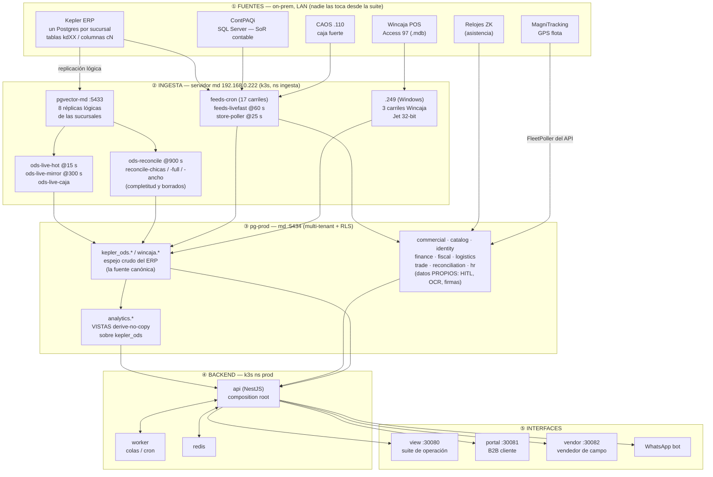
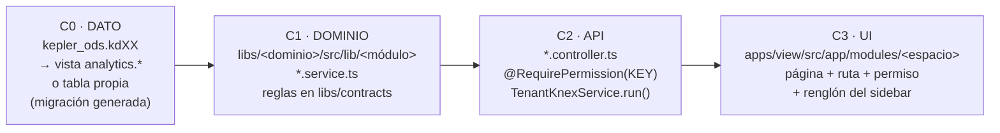
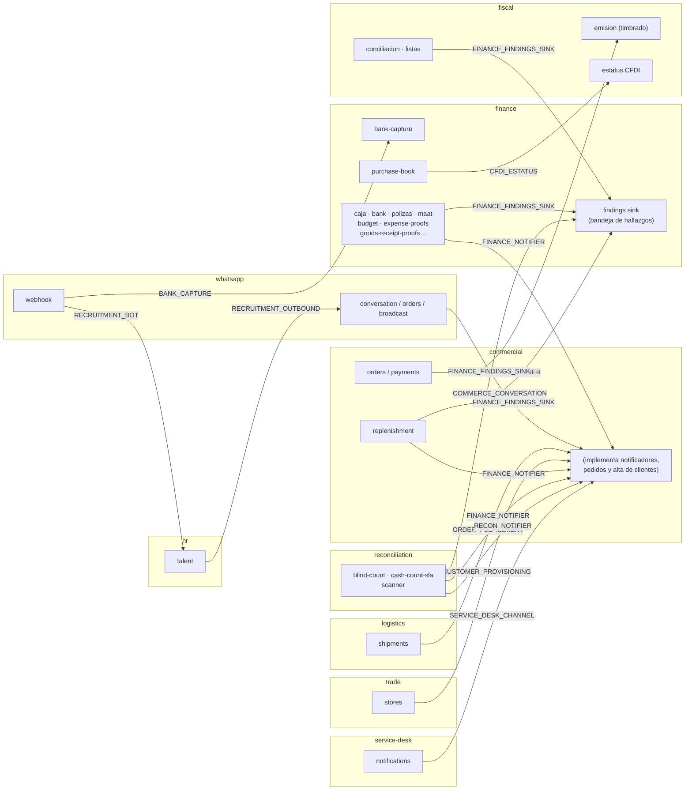
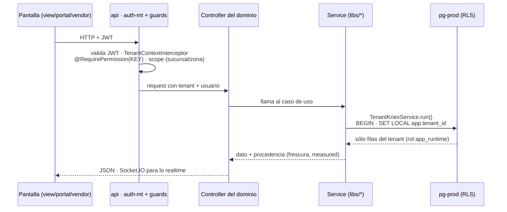
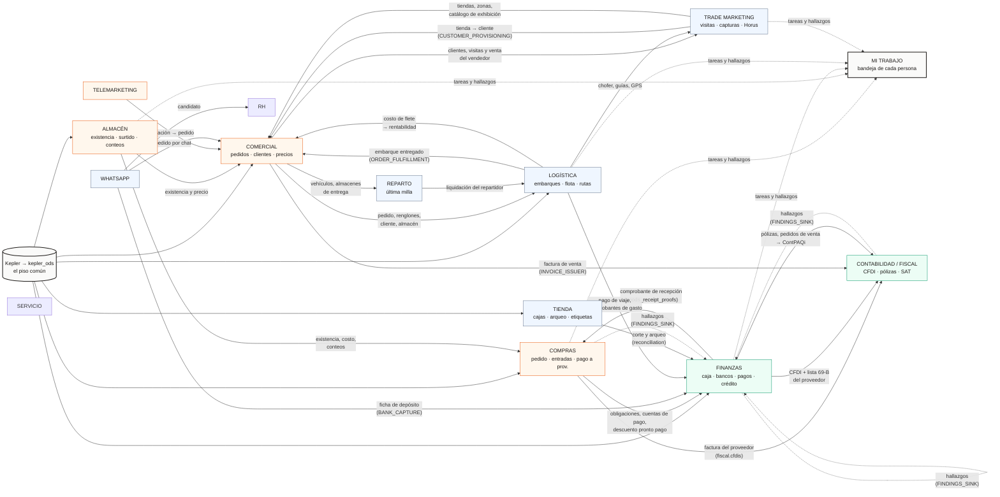
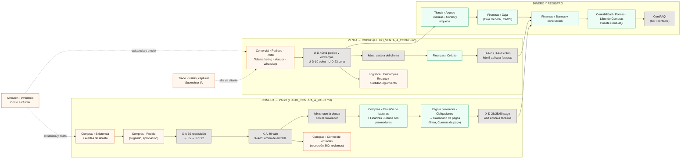

# Mapa de módulos — cómo se implementa y cómo se conecta todo

> Un solo lugar para ver la suite completa: **de dónde nace el dato, por dónde pasa, qué módulo
> lo usa y cómo se hablan los módulos entre sí.** Medido contra el código el **2026-10-27**
> (`apps/`, `libs/`, `apps/api/src/composition/`, `layout.component.ts`, `ops/k3s/`).
>
> Este doc es el **índice**; el detalle vive en otros:
> [`ARCHITECTURE.md`](ARCHITECTURE.md) (código) · [`ARQUITECTURA_DATOS.md`](ARQUITECTURA_DATOS.md)
> (tablas y FKs) · [`ops/README.md`](../ops/README.md) (qué corre dónde) ·
> [`ERP_KEPLER.md`](ERP_KEPLER.md) (doctypes) · [`FLUJO_COMPRA_A_PAGO.md`](FLUJO_COMPRA_A_PAGO.md) ·
> [`FLUJO_VENTA_A_COBRO.md`](FLUJO_VENTA_A_COBRO.md).
>
> ⚠️ `ARQUITECTURA_DATOS.md` §1 todavía dibuja **Railway** como prod y `.245` como consolidación.
> Las dos cosas quedaron atrás: prod es `pg-prod` en el servidor `md` (k3s) desde el 2026-09-22,
> y `.245` ya no se usa. El diagrama §1 de este doc es el vigente.

---

## 1. Las capas físicas (de la fuente a la pantalla)



**Las cuatro reglas que ordenan este dibujo:**

1. **Toda cifra del ERP sale de `kepler_ods`**, de **una** tabla principal, y se le da forma con una
   **vista** en `analytics.*`. No hay importers nuevos ni copias (reglas 1 y 2 de `CLAUDE.md`).
2. **Las tablas propias** (`commercial.*`, `finance.*`…) guardan **sólo lo que la suite crea**: una
   firma, un conteo, una solicitud, un OCR, un hallazgo. No guardan una segunda versión del ERP.
3. **Las apps leen siempre de `pg-prod`**, nunca de Kepler, Wincaja o ContPAQi directo.
4. **La frescura de cada carril se ve en `/admin/db-health`** (latidos `cron_runs` / `ods.ctl`).

---

## 2. Cómo se implementa un módulo (las 4 capas)

Cada módulo de negocio tiene las mismas cuatro capas, en este orden. Una fase **no sube de capa**
hasta que la de abajo está verificada ([`METODO_DE_TRABAJO.md`](METODO_DE_TRABAJO.md)).



| Capa | Dónde vive | Qué la verifica |
|---|---|---|
| C0 dato | `database/migrations*/`, vistas sobre `kepler_ods` | lectura de prod contra un testigo independiente (ADR-059) |
| C1 dominio | `libs/<dominio>/src/lib/<módulo>/` | `vitest` del lib + reglas en `libs/contracts` |
| C2 API | controller del mismo lib, cableado en `apps/api` | prueba contra base real para lo que **escribe** (regla 13) |
| C3 UI | `apps/view/src/app/modules/<espacio>/pages/` | `check:pantalla`, `check:templates`, `check-sidebar-tabs` |

**El permiso es la costura entre capas:** una **clave** del enum (`Permission.X`, ADR-054) la usa el
controller (C2), la ruta y la pestaña (C3), y se **reparte** en prod a los roles (regla 20). El
sidebar no da ni quita acceso: sólo muestra lo que el permiso ya permite.

---

## 3. El backend: dominios y cómo se hablan

`apps/api` es **delgado**: trae la plataforma (`auth`, `auth-mt`, `cron`, `db-health`,
`kepler-consolidado`, `kp`, `store`, `tenants-admin`, `catalogo-interno`, `dev-projects`) y cablea los
dominios. **En el código, los dominios no se importan entre sí**: cuando uno necesita *ejecutar* algo
de otro, declara un **puerto** en `libs/contracts` y `apps/api/src/composition/*.binding.module.ts` le
conecta la implementación.

⚠️ **En SQL sí se cruzan, y mucho**: los puertos son la costura del *código*, pero casi todo el acople
real entre módulos es **un dominio leyendo directo la tabla de otro** (§5). No es un defecto en sí
—todos comparten la misma base—, pero es lo que hay que recorrer antes de cambiar una tabla.

### 3.1 Los dominios (`libs/`)

| Lib | Qué resuelve | Módulos principales |
|---|---|---|
| `platform-core` | Infra compartida (hoja: no depende de nadie) | database/tenant (RLS), ability (permisos), scope, cache, queue, storage, ai, ai-product-matcher, provenance, pdf |
| `contracts` | Tipos, DTOs, **puertos** y reglas que comparten dos pantallas | — (sin runtime) |
| `commercial` | Todo lo que vende, compra y mueve mercancía | orders, customers, pricing, promotions, products, inventory, **replenishment** (pedido), **receiving** (entradas), picking, televenta, quotes, sales-documents, tickets, route-control, profitability, standard-cost, intelligence (Thot), push |
| `finance` | El dinero | **payment-calendar**, pagos, payment-program, creditor-statements, bank, caja, caos, cortes-sucursales, collection-deposits, customer-ledger, expense-*, budget, contpaqi, polizas, purchase-book, trip-pay, maat |
| `fiscal` | SAT y contabilidad | cfdi, descarga, estatus, emision, listas (69-B), diot, impuestos, conciliacion, contabilidad, materialidad, vault |
| `logistics` | Entregar | shipments, erp-shipments, routing, tracking, fleet, fleet-cost, guides, payroll, trip-closure, checklists, cartaporte |
| `trade` | Ejecución en punto de venta (el negocio original) | visits, daily-captures, scoring, planograms, stores, reports, commercial-map, supervisor-ai (Horus), websocket |
| `reconciliation` | Cuadres de caja e inventario | cash-cuts-sync, blind-count, movement-reconcile, scanner de descuadres |
| `hr` | Personas | attendance (relojes), talent (reclutamiento) |
| `service-desk` | Mesa de servicio | requests, routing, sla, notifications, dictado |
| `whatsapp` | Canal conversacional | webhook, conversation, orders, broadcast, promos |

### 3.2 Los puertos (las únicas costuras entre dominios)

Medido de los 14 `*.binding.module.ts` y de quién hace `@Inject(<PUERTO>)`:



| Puerto | Lo pide | Lo implementa | Para qué |
|---|---|---|---|
| `ORDER_FULFILLMENT_PORT` | logistics/shipments | commercial | un embarque marca surtido/entregado el pedido |
| `INVOICE_ISSUER_PORT` | commercial/orders, payments | fiscal | facturar (timbrar) un pedido o un pago |
| `CFDI_ESTATUS_PORT` | finance/purchase-book | fiscal | ¿la factura del proveedor sigue vigente en el SAT? |
| `CUSTOMER_PROVISIONING_PORT` | trade/stores | commercial | una tienda de trade se vuelve cliente comercial |
| `COMMERCE_CONVERSATION_PORT` | whatsapp | commercial | el bot consulta catálogo/precio y levanta pedido |
| `BANK_CAPTURE_PORT` | whatsapp/webhook | finance | una foto de ficha de depósito entra a bancos |
| `FINANCE_FINDINGS_SINK_PORT` | 10 módulos (finance, fiscal, replenishment) | finance | **una sola bandeja** de hallazgos (ADR-056) |
| `FINANCE_NOTIFIER_PORT` · `RECON_NOTIFIER_PORT` · `HEALTH_NOTIFIER_PORT` | caja, bancos, cuadres, db-health… | commercial / whatsapp | avisar (realtime, push, WhatsApp) |
| `RECRUITMENT_BOT_PORT` · `RECRUITMENT_OUTBOUND_PORT` | whatsapp ↔ hr/talent | hr / whatsapp | reclutamiento por WhatsApp |
| `SERVICE_DESK_CHANNEL_PORT` · `MAILER_PORT` | service-desk, db-health | commercial / api | canales de aviso de la mesa de servicio y correo |

### 3.3 Un request, de punta a punta



⛔ Sin tenant, RLS devuelve **cero filas**, no un error. Cero filas por defecto y cero por desuso se ven
igual ([`GOTCHAS.md`](GOTCHAS.md)).

---

## 4. El frontend: espacios → módulos → dominio

`apps/view` se divide en **espacios** (`apps/view/src/app/modules/<espacio>`); cada uno tiene su
sidebar en `layout.component.ts`. Un renglón con `tabs:` es un **apartado**: una entrada que abre una
barra de pestañas, y cada pestaña conserva su propio permiso.

| Espacio | Grupos del sidebar (hoy) | Dominio backend principal |
|---|---|---|
| **Mi trabajo** (`/projects`) | bandeja por responsabilidad, Cuadro de Resultados por Puesto | todos (lee) |
| **Trade** (`/dashboard`) | Dashboard, Captura diaria, Reportes, Seguimiento, Mapas, Supervisor IA, Asignación, Tiendas, Planograma | `trade` |
| **Comercial** | Ventas · Precios y promociones · Ruta y vendedores · Reportes | `commercial` |
| **Telemarketing** | Mi turno · Lo que sale del canal (cotizaciones, facturación) | `commercial/televenta`, `quotes`, `sales-documents` |
| **Compras** | Compra · Recepción y pago · Catálogo y costos | `commercial/replenishment`, `receiving` + `finance/payment-calendar`, `creditor-statements` |
| **Almacén** (WMS) | existencia, surtido, cuadre, movimientos | `commercial/inventory`, `picking`, `movements` |
| **Reparto** | Surtido, Asignar, Pedidos WhatsApp, Seguimiento, Cortes | `commercial/home-delivery`, `rider-liquidation` |
| **Logística** | Operación · Flota y personal · Costos y reportes | `logistics` |
| **Tienda** | Operación (verificador, en vivo, cajas) · Análisis y control (arqueo, caducidades, etiquetas) | `commercial/tickets`, `labels`, `reconciliation` |
| **Finanzas** | Ingresos · Caja y bancos · Egresos · Registro y análisis | `finance` |
| **Contabilidad** | Fiscal/SAT · Facturación · Contabilidad · Impuestos · Credenciales | `fiscal` + `finance/contpaqi`, `polizas`, `purchase-book` |
| **RH** | Asistencia, Incidencias, Relojes | `hr` |
| **Servicio** | Bandeja, Mis solicitudes, Reportes, Configuración | `service-desk` |
| **Administración** | Personas, Puestos, Responsabilidades, Roles, Salud DB | `api` (auth-mt, tenants-admin, db-health) |
| **Desarrolladores** | Proyectos | `api/dev-projects` |

Las otras apps: **`portal`** (el cliente B2B pide y paga; usa `commercial`), **`vendor`** (el vendedor
de campo, offline con Dexie; usa `commercial` + `trade`) y el **bot de WhatsApp** (`whatsapp` →
puertos de `commercial` y `finance`).

---

## 5. Cómo conviven los módulos (medido en el código)

> Medido el 2026-10-27 recorriendo `libs/*/src` (sin `.spec.ts`): por cada dominio, qué tablas de
> **otro** dominio nombra en su SQL. Script de sólo lectura, sin tocar la base. Es acople por
> **lectura/escritura de tabla** —el que de verdad ata a dos módulos—, más los puertos del §3.2.

### 5.1 Las tres formas en que dos módulos se conectan

1. **Comparten el ERP.** Todos leen el mismo `kepler_ods`: es el piso común y por eso dos pantallas
   de espacios distintos pueden coincidir sin hablarse. Las tablas más leídas: `kdm1`/`kdm2`
   (movimientos, 101 menciones), `kdii` (existencia, 34), `kdxe`/`kdxf` (deuda y pago a proveedor, 30),
   `kduv`/`kdud` (venta y clientes, 20), `kdm5`/`kdue` (cobro y cartera, 8).
2. **Uno lee (o escribe) la tabla propia del otro.** Es el acople directo; la tabla de §5.3.
3. **Uno le pide al otro que haga algo, por un puerto** (§3.2): facturar, marcar un pedido surtido,
   dejar un hallazgo, avisar.

### 5.2 El mapa de convivencia

Cada flecha es **lo que pasa** de un módulo a otro, con la tabla o el puerto que lo lleva.



**Cómo se lee:**

- **Compras y Finanzas son el par más atado**: comparten la deuda con el proveedor de punta a punta
  (Compras la origina, Finanzas la paga) y se pasan los comprobantes en las dos direcciones.
- **Comercial es el centro de la operación**: la mayoría de los demás leen sus tablas `commercial.*`.
  Logística lee sus pedidos, Trade sus clientes, Finanzas sus almacenes.
- **Trade Marketing convive con Comercial por el cliente**: la tienda auditada y el cliente que
  compra son la misma persona en dos tablas (`trade.stores` ↔ `commercial.customers`). El puerto
  `CUSTOMER_PROVISIONING` convierte una en la otra. Horus (Supervisor IA) además cruza lo que el
  vendedor visitó y vendió con lo que Logística entregó.
- **Contabilidad es el destino**: recibe facturas de los dos lados (compra y venta) y las pólizas,
  y sólo devuelve validaciones (vigencia del CFDI, lista 69-B).
- **RH y Servicio viven casi aislados**: sólo leen `identity` (quién es quién). RH se conecta con
  el resto únicamente por WhatsApp (reclutamiento).
- **Mi trabajo no produce nada: junta** las tareas de todos en la bandeja de cada persona.

### 5.3 Quién lee la tabla de quién (el acople directo)

Total de tablas distintas de **otro** dominio que nombra cada lib (sin contar `analytics`, `kepler_ods`
ni `identity`, que son de todos):

| Lib ↓ lee de → | commercial | finance | fiscal | trade | logistics |
|---|---:|---:|---:|---:|---:|
| **commercial** | — | 9 | 12 | 4 | 7 |
| **finance** | 9 | — | 4 | — | 2 |
| **fiscal** | 1 | 1 | — | — | — |
| **trade** | 31 | 15 | 1 | — | 6 |
| **logistics** | 8 | 2 | — | — | — |
| **reconciliation** | 2 | — | — | — | — |

Los cruces que importan, con su tabla y el módulo que la usa:

| De → a | Tabla | Quién la usa | Qué significa en el negocio |
|---|---|---|---|
| Compras → Finanzas | `commercial.supplier_payment_obligations` | finance: payment-calendar, creditor-statements, pronto-pago, budget | la deuda que nace en Compras es la que Finanzas programa y paga |
| Compras → Finanzas | `commercial.supplier_payment_accounts` | finance: payment-calendar | sin cuenta del proveedor no se prepara el pago |
| Compras → Finanzas | `commercial.supplier_discount_policy` | finance: pronto-pago | cuánto se ahorra pagando antes |
| Finanzas → Compras | `finance.goods_receipt_proofs` | commercial: replenishment, obligations | el comprobante de la recepción respalda la obligación |
| Compras/Finanzas → Fiscal | `fiscal.cfdis`, `fiscal.sat_list_rfcs` | commercial-replenishment; finance: goods-receipt-proofs, purchase-book, caja, maat | la factura del proveedor existe, está vigente y el RFC no está en 69-B |
| Comercial → Logística | `commercial.orders`, `order_lines`, `customers`, `warehouses` | logistics: shipments, routing, guides, cartaporte, tracking | lo que se vendió es lo que se embarca |
| Logística → Comercial | `logistics.shipments`, `routes`, `vehicles`, `shipment_expenses` | commercial: orders, customers, profitability, route-profit | estado de entrega y costo de flete en la rentabilidad |
| Logística → Finanzas | `logistics.drivers`, `v_trip_pay_items` ↔ `finance.trip_pay_lines`, `expense_proofs` | finance: trip-pay · logistics: trip-closure | el viaje cerrado se vuelve pago al chofer y gasto comprobado |
| Comercial ↔ Trade | `commercial.customers`, `vendor_visits`, `vendor_sale_lines`, `route_tickets` ↔ `trade.stores`, `catalogs`, `zones` | trade: daily-captures, commercial-map, reports, supervisor-ai · commercial: vendor-routes, vendor-sales | la visita de ejecución y la venta del vendedor se cruzan por tienda |
| Trade → Logística | `logistics.delivery_guides`, `drivers`, `trackers`, `vehicle_stops` | trade: supervisor-ai | Horus contrasta lo visitado con lo entregado |
| Comercial → Fiscal | `fiscal.cfdis`, `issuer_config` + datos fiscales del cliente | commercial: orders, sales-documents, tickets | facturar la venta |
| Finanzas → Comercial | `commercial.orders` | finance: contpaqi | la venta que va a póliza |
| Tienda → Comercial | `commercial.warehouses`, `route_warehouses` | reconciliation: blind-count, cash-cuts-sync | el corte y el arqueo se cuadran por almacén |

⚠️ **Hallazgo: la bandeja de «Mi trabajo» vive en `libs/trade`** (`users/me-work.ts`, `me-tasks.ts`)
y por eso `trade` aparece leyendo **15 tablas de finanzas** y 31 de comercial
(`recon_tasks`, `payment_calendar_lots`, `cash_ledger_cuts`, `purchase_requisitions`,
`inventory_counts`, `fleet_alerts`…). No es que Trade Marketing dependa de Finanzas: es que la
bandeja de todos quedó alojada en el lib de Trade por historia. Si se mueve, hay que llevarse esos
dos archivos (deuda con nombre, no se tocó).

---

## 6. Cómo se interconecta el negocio (el flujo completo)

Las cajas grises son **Kepler** (el ERP donde se asienta la operación). Las de color son **pantallas
de la suite**. La suite **lee** a Kepler por el ODS; hoy **no escribe** en él (§7).



**Los eslabones que unen los procesos** (cada uno es un lugar donde una cifra cruza de un módulo a
otro, y por eso donde más se ha roto algo):

| Eslabón | Sale de | Entra a | Cifra que cruza |
|---|---|---|---|
| Existencia y costo | ODS `kdik` / costo estándar `c77` | Pedido de compra, precios, rentabilidad | piezas en unidad base, costo por pieza ([`UNIDADES_DE_MEDIDA.md`](UNIDADES_DE_MEDIDA.md)) |
| Orden de entrada → deuda | `X-A-20` | `kdxe` → Obligaciones | importe a pagar y su vencimiento (`c18`) |
| Pago → factura | `X-D-26` (`c45` = cuenta de tesorería) | `kdxf` → Deuda con proveedores | qué facturas salda cada pago |
| Venta → cartera | `U-D-*` | `kdue` → Crédito | saldo del cliente (cuidado: espejos `U-D-13` en Oficinas) |
| Cobro → factura | `U-A-5/7` | `kdm5` (`c13`) → Crédito | qué facturas salda cada cobro |
| Corte → caja → banco | `U-D-23`, arqueo | Caja General → Bancos | efectivo entregado, depositado, conciliado |
| Movimiento → póliza | bancos, compras, gastos | ContPAQi | asiento contable (la suite arma el TXT, no escribe en ContPAQi) |

### 6.1 Caso trazado: de Pedido al Calendario de pagos

> Trazado el 2026-10-27 con el grafo de graphify sobre `libs/` (19,536 nodos) y verificado a mano
> en el código. **En el código, `commercial/replenishment` (Pedido) y `finance/payment-calendar`
> (Calendario) NO se conectan**: ningún import ni llamada real los une. Se conectan por **Kepler y
> por tablas compartidas**.

```
Compras › Pedido (commercial/replenishment)
   │  aprueba → se recaptura en Kepler (la escritura Suite→Kepler está apagada)
   ▼
Kepler: X-A-30 requisición → 35 → 37 OC → 40 vale → 20 orden de entrada
   │  nace la deuda en kdxe
   ▼
kepler_ods.kdxe ──► analytics.v_supplier_payables (vista)
   │                       │
   │                       └─► llave sqlKeplerPayableId()  (libs/contracts/src/finance/kepler-payable-key.contract.ts)
   ▼                                   │
commercial.supplier_payment_obligations ┤   ← tablas que finance lee por SQL
commercial.supplier_payment_accounts    ┤
   ▼                                   ▼
finance/payment-calendar  ◄── finance/pronto-pago (qué factura conviene adelantar)
   │
   ▼  pago en la banca en línea → Kepler X-D-26 → kdxf aplica el pago a la factura
```

**El único acople de código** son dos primitivos de `libs/contracts`: `sqlKeplerPayableId()` (la
llave determinística de una factura de Kepler sin tabla propia, `[TP.18.7]`) y
`sqlVentanaProntoPago()`. Los usan `finance/payment-calendar`, `finance/pronto-pago` y
`commercial/entity-ref` (que pinta qué factura es cada renglón del Calendario). **Pedido no los usa.**

**Lo que implica:**
1. **Un cambio en Pedido no rompe el Calendario por código; lo rompe por datos.** Si cambia cómo se
   forma la deuda (la vista, la llave o la tabla de obligaciones), ningún import lo delata: hay que
   recorrer las tres piezas del diagrama.
2. **El eslabón Pedido → OC lo cierra una persona recapturando en Kepler.** Es el hueco que la fase
   `PQ` quiere cerrar con la escritura a Kepler.

⚠️ **graphify da caminos falsos entre módulos.** Los 8 caminos más cortos que devolvió (sin la
plomería `Param`/`TenantKnexService`/`Permission`) eran: 4 por llamadas **inferidas por nombre**
(`.create()`, `.row()`: «se llaman igual», no «se llaman entre sí») y 2 por los `index.ts` de
reexportación. Con la plomería incluida, todo se une en 2 saltos vía `contracts/index.ts`. Y no ve el
SQL. **Para preguntar cómo se conectan dos módulos, manda el acople por tabla del §5.3**; el grafo
sirve para navegar *dentro* de un dominio. Si se usa, descartar las aristas `INFERRED` y los saltos
por `index.ts`.

---

## 7. Lo que la suite escribe hacia afuera

| Destino | Estado | Cómo |
|---|---|---|
| **Kepler** | ⛔ **apagado** | El empuje Suite → Kepler (pedido, traspaso, `X-D-26`) existe en diseño (`KR`, `PGP`, `PQ`) pero no está encendido. Hoy lo aprobado en la suite se **recaptura** en Kepler. |
| **ContPAQi** | sólo archivo | ADR-040: ContPAQi es el SoR contable; la suite arma el TXT/puente y nunca escribe directo. |
| **SAT** | sí | timbrado de CFDI (`fiscal/emision`, vía PAC) y descarga masiva (`fiscal/descarga`). |
| **WhatsApp / push / correo** | sí | por los puertos notificadores (§3.2). |
| **Bancos** | ⛔ no | el pago sale por la banca en línea; la suite prepara y firma, no transfiere. |

---

## 8. Mantener este mapa vivo

- Un **puerto nuevo** = un renglón en §3.2 (de dónde sale: `ls apps/api/src/composition`).
- Un **espacio o grupo nuevo del sidebar** = un renglón en §4 (de dónde sale: `layout.component.ts`).
- Un **carril de ingesta nuevo** va en [`ops/README.md`](../ops/README.md), no acá; acá sólo si cambia la forma del §1.
- Un **eslabón de negocio nuevo** (una cifra que pasa de un módulo a otro) = un renglón en la tabla del §6.
